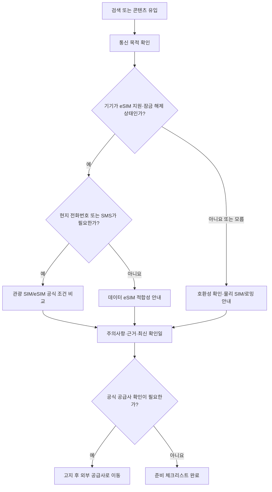
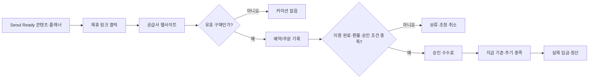
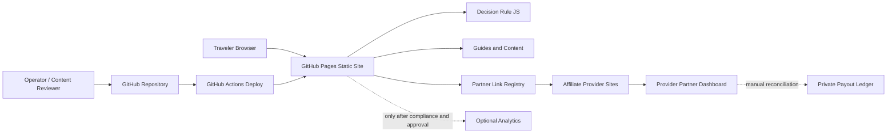

# Seoul Ready — 전체 서비스 제품요구사항 정의서(PRD)

> **서비스명:** Seoul Ready — Korea Travel Essentials  
> **사업 주체:** Decisionary (디시저너리)  
> **문서 유형:** Product Requirements Document / 사업·서비스·운영·데이터·실험 통합 명세  
> **버전:** v1.0  
> **작성 기준일:** 2026-11-02 (KST)  
> **문서 상태:** 제품 방향 제안 및 개발 기준안. 실제 제휴 승인·매출·고객 검증 미완료  
> **저장소:** https://github.com/decisionarypro/seoul-ready  
> **목표 배포 주소:** https://decisionarypro.github.io/seoul-ready/ (실제 가동·배포 성공 여부는 별도 확인)  
> **기본 서비스 언어:** 영어(EN), 운영 문서 한국어(KO)  
> **핵심 원칙:** 고객 가치 선행 → 유효한 구매 의도 검증 → 제휴 수익화 → 경제성 확인 후 확장

---

## 문서 읽는 법 / 정의

- **[현행]** 2026-11-02 GitHub `main` 브랜치에서 실제 파일과 코드를 확인한 내용. 웹 배포 성공이나 기능의 운영 성과까지 확인했다는 의미는 아니다.
- **[필수/MVP]** 초기 사업 검증을 위해 반드시 구현·검증할 요구사항.
- **[고도화/P1]** 유효 클릭·실구매 신호가 확보된 후에 수행할 우선순위.
- **[확장/P2]** 리셀러/화이트라벨, 공급자 데이터 연동, 타 목적지 등 후속 사업 가설.
- **[가설]** 실제 고객 실험 이전의 추정. 사용자 니즈, 전환율, 객단가, 획득 비용은 사실로 간주하지 않는다.
- **승인된 제휴 링크:** 공급사 또는 공식 네트워크가 발급한 추적 URL. 일반 공급사 URL과 엄격히 구분한다.
- **성과의 단계:** 클릭 발생 ≠ 예약 생성 ≠ 체험 완료 ≠ 수수료 승인 ≠ 현금 입금.

### 0.1 기준 저장소 검토 내역

| 파일 | 확인된 용도 | 상태 |
|---|---|---|
| `index.html` | 영문 홈, 상품·체험 소개, 2문항 플래너, CTA | [현행] |
| `assets/site.js` | 모바일 메뉴, 플래너 결과 생성, 공급사 링크 설정 | [현행] |
| `assets/partners.js` | Airalo/Viator/systeme의 공식 URL 및 빈 affiliate 필드 | [현행], **수익 추적 비활성** |
| `assets/styles.css` | 반응형 디자인 | [현행] |
| `guides/korea-esim-guide.html` | 한국 eSIM/SIM 선택 가이드 | [현행] |
| `guides/first-48-hours.html` | 서울 도착 후 48시간 가이드 | [현행] |
| `disclosure.html` | 제휴·편집 원칙·개인정보 관련 안내 | [현행] |
| `.github/workflows/deploy.yml` | GitHub Pages Actions 배포 | [현행] 파일 존재. 실행 성공 여부는 별도 검증 |
| `README.md`, `.nojekyll`, `robots.txt`, SVG 자산 | 운영·빌드·색인 보조 | [현행] |

**현행 사실과 요구사항의 경계:** 사이트에는 자체 예약엔진, 카드 결제, 사용자 계정, 실시간 가격·재고 API, CRM, 구매·정산 DB, 상용 웹분석 도구가 없다. 플래너는 브라우저 안에서만 실행되며 사용자 입력을 수집하지 않는다. 공개된 제휴 링크의 추적 파라미터 또한 현재 설정돼 있지 않다. 이 PRD는 **이미 있는 기능을 근거로 추정된 기능을 완료 처리하지 않는다.**

---

# 1. 제품 개요

## 1.1 한 줄 정의

**한국, 특히 서울을 처음 방문하는 해외 여행자가 출발 전에 통신·공항 도착·이동·현지 체험을 자신의 상황에 맞게 결정하도록 돕고, 적합한 공급사 구매로 연결하는 독립적인 여행 의사결정 서비스.**

Seoul Ready는 초기에는 예약·결제·상품 판매의 거래당사자가 아닌 **여행 결정 지원 + 제휴 추천(affiliate referral)** 서비스다. 소비자의 거래는 각 공급사에서 발생한다.

## 1.2 문제 정의

첫 한국 여행자는 여행 준비 시 검색 결과·커뮤니티·공급사 페이지를 넘나들며 다음의 어려움을 겪을 수 있다.

1. **통신의 선택 실패 위험:** 내 휴대전화가 eSIM을 지원하는지, 잠금 해제 상태인지, 데이터 전용으로 충분한지, 한국 전화번호·SMS가 필요한지 판단하기 어렵다.
2. **입국일의 복잡성:** ICN/GMP 도착 공항, 숙소 위치, 짐, 도착 시각에 따라 공항철도·버스·택시 등의 적합성이 달라진다.
3. **체험 예약 과잉:** 유명 상품 목록은 많지만, 일정과 동선 및 실제 제약(운영일, 미팅 장소, 언어 등)을 고려한 선택 지원은 부족할 수 있다.
4. **출처 신뢰의 문제:** 광고성 추천, 오래된 가격·이용 정보, 실제 테스트 여부가 불명확한 후기 때문에 비교 비용이 커진다.
5. **선택 후 다음 단계 단절:** 통신·이동·체험이 따로 검색되므로 준비가 완료되었는지 알기 어렵다.

이 문제의 강도·빈도는 아직 인터뷰와 행동 데이터로 검증되지 않았다. SEO 검색량이나 관광객 규모가 크다는 사실만으로 본 서비스 사용 수요가 증명되지 않는다.

## 1.3 제안하는 해결책

- 방문자의 **여행 제약조건을 먼저 수집**하고 맞지 않는 상품을 제거한다.
- 공항 → 데이터 통신 → 첫날 이동 → 체험 예약의 **실행 순서**에 맞춰 안내한다.
- 추천 결과에 **추천 이유, 제외 이유, 확인해야 할 사항, 출처·최신 확인일**을 표시한다.
- 구매가 필요한 경우에만 제휴 공급사로 이동시키며, 구매하지 않는 선택도 동등하게 제공한다.
- 사용자가 출발 전에 해야 할 일을 **개인화 체크리스트**로 남길 수 있도록 점진적으로 발전시킨다.

## 1.4 와우 팩터(차별 가치)의 정의

**“내 상황에서는 이것을 사면 되고, 이것은 사지 않아도 되며, 출발 전에 무엇을 확인해야 하는지 2분 안에 알게 해준다.”**

기능을 많이 나열하는 것보다 **잘못된 구매를 방지하는 신뢰성**이 핵심이다. 가격이 가장 낮다거나 완전한 시장 최적해를 보장하지 않는다. 고객이 체감할 구체적 성과는 검색 탭 수 감소, 사전 준비 누락 감소, 의사결정 시간 단축, 불필요한 구매 회피다.

### 1.4.1 현재 2문항 플래너에 대한 비판적 판단

현행 플래너는 `duration`(짧음/보통/김)과 `interest`(음식/문화/명소) 두 가지 입력으로 안내 문구·3~4개 체크리스트를 생성한다. **이것만으로는 eSIM 호환성, 한국 전화번호 필요 여부, 도착 공항·숙소, 이동 대안을 판단할 수 없으므로 강력한 구매 의사결정 도구라고 보기는 어렵다.**

따라서 **플래너 사용 횟수를 주요 성공지표로 삼지 않는다.** 이탈률을 높이는 긴 설문 대신, 실제 구매 결정에 영향을 주는 질문만 단계별로 제시해야 한다. 기존 2문항 플래너는 유입용 미니 경험으로 유지하거나 단계적으로 개선한다.

## 1.5 제품 비전과 단계별 사업 정의

| 단계 | 고객이 얻는 가치 | 서비스 책임 | 수익 구조 | 전제조건 |
|---|---|---|---|---|
| 0. 정보형 마이크로사이트 | 여행 기본정보·판단 체크리스트 | 편집·출처·링크 관리 | 없음 | 현재 구현에 가까움 |
| 1. Affiliate MVP | 개인 상황별 추천 + 공식 구매 연결 | 추천 품질, 투명한 고지, 제휴 링크 품질 | 유효 판매 커미션 | 파트너 승인·측정·고지 |
| 2. 의사결정 플랫폼 | 상황별 비교·저장·시나리오 가이드 | 비교 데이터 관리·실험 | 제휴 수익 다변화 | 반복 방문·수요 확인 |
| 3. 리셀러/화이트라벨 **별도 프로젝트** | 자사 서비스 내 구매 경험 | 결제·환불·고객 지원 등 범위 확대 | 재판매 마진 또는 계약 수익 | 서면 계약·운영·법률·결제 체계 |

**사업 전략상 제한:** 여행 소비자와 온라인 창업 SaaS 고객은 문제·채널·브랜드가 다르다. `systeme.io`가 현재 링크 레지스트리에 있다고 해도 Seoul Ready 여행 화면에 혼합 노출하지 않는다. SaaS용 어필리에이트는 **별도 브랜드/사이트와 별도 PRD**로 운영한다.

## 1.6 핵심 제품 원칙

1. 사용자 이익에 반하는 상품은 수수료가 높아도 추천하지 않는다.
2. 미가입 공급사를 공식 파트너처럼 표시하지 않는다.
3. 실시간 가격·이용 가능 여부를 확인할 수 없다면 **실시간처럼 표현하지 않는다.**
4. 링크 클릭이 아닌 **유효 거래 및 실제 입금액**으로 사업 성과를 판단한다.
5. 검증할 수 없는 후기, 별점, 방문 경험, 사용 경험을 생성하지 않는다.
6. 복잡한 사용자 계정·대금 처리·API부터 개발하지 않는다.
7. 고객 추천의 **근거와 제약조건**을 모두 설명 가능해야 한다.
8. 공급사 정책, 법률, 검색엔진 정책을 우회하는 성장 전략을 사용하지 않는다.

---

# 2. 사업 목표 및 비목표

## 2.1 1차 사업 목표

- **G1 — 고객문제 검증:** 실제 잠재 사용자들이 통신·도착·현지 체험 결정을 위해 외부 가이드를 필요로 하는지 확인한다.
- **G2 — 제품 유용성 검증:** 방문자가 도움을 얻었다고 느끼며 적절한 다음 행동을 하는지 확인한다.
- **G3 — 판매 가능성 검증:** 제휴 승인 후 유효 거래 발생 여부와 상품별 단위경제성을 확인한다.
- **G4 — 반복 가능한 콘텐츠 채널 검증:** 유입 비용이 낮고 품질이 유지되는 채널을 식별한다.
- **G5 — 운영 가능성 검증:** 최소 인력으로 정보 업데이트·링크 검증·정산 관리를 지속할 수 있는지 확인한다.

## 2.2 주요 검증 질문

| ID | 질문 | 실패 가능성 | 실험 방식 |
|---|---|---|---|
| H01 | 첫 서울 방문자가 출발 전 eSIM 선택의 불확실성을 경험하는가? | 이미 eSIM 플랫폼에서 충분히 해결 | 인터뷰 10~15건, 콘텐츠 진입 경로 조사 |
| H02 | 사용자는 단순 상품 목록보다 상황별 **제외/추천 이유**를 선호하는가? | 추천 설명 자체가 번거로움 | 비교페이지 A/B 또는 순차 비교 테스트 |
| H03 | 신뢰성 있는 체크리스트가 구매로 이어지는가? | 읽기만 하고 공급사로 직접 검색 | 유효 아웃바운드 클릭 및 커미션 관찰 |
| H04 | 서울 도착 정보와 체험 추천의 연계가 가치가 있는가? | 통신과 체험은 서로 독립적인 수요 | 콘텐츠별 퍼널·사용자 인터뷰 |
| H05 | 무료·저비용 채널에서 구매 의도가 있는 방문자를 확보할 수 있는가? | 높은 SEO 경쟁·낮은 콘텐츠 도달 | 콘텐츠/키워드별 30~60일 테스트 |
| H06 | 파트너 조건이 한국 사업자에게 운영 가능한가? | 심사 거절·정산 장벽·광고 제한 | 실제 신청·지급 설정 확인 |
| H07 | 관리 가능한 적은 콘텐츠로도 고객에게 원본 가치가 생기는가? | 업데이트 부담·정보 복제 | 콘텐츠 품질 리뷰·사용자 반응 |
| H08 | 제휴 이익만으로 운영비를 감당할 수 있는가? | 커미션이 낮고 구매당 비용 높음 | 시나리오 모델·실제 지급액 추적 |

모든 가설의 **승인 조건과 실패 판단은 12장에서 구체화**한다.

## 2.3 초기 비목표(Non-goals)

- 항공권·호텔·투어 **자체 예약/발권/취소/환불 기능**.
- 실시간 OTA 수준의 가격·재고 통합 비교를 제공하는 것.
- 개인 여행 일정의 완전 자동 생성 또는 최저가 보장.
- 회원가입, 결제정보 저장, 여행자 여권정보 보관.
- 사용자 후기 커뮤니티, SNS 피드, 광고 네트워크 운영.
- 모든 한국 여행 목적지/모든 언어로의 동시 확장.
- AI 챗봇 자체를 주력 상품으로 제공하는 것.
- 관광 제휴상품 외 SaaS 제휴상품의 브랜드 혼합 판매.

## 2.4 사업 실패를 의심할 신호

- 검색 방문자는 많으나 여행 준비 의도가 확인되지 않는다.
- 사용자는 정보를 유용하게 평가하지만 추천 링크를 이용하지 않고 공급사로 직접 간다.
- 제휴 승인·정산 조건을 충족할 수 없다.
- 월 환산 승인 커미션이 콘텐츠 유지비·검수비를 지속적으로 충당하지 못한다.
- 동종 사이트와 차별화되는 독자 정보·검증 방법을 확보하지 못한다.
- 여행 정보 오류로 고객 오인·불신이 발생하고, 수정 체계를 감당할 수 없다.

---

# 3. 시장 정의와 사용자 이해

## 3.1 1차 시장

**영어로 서울 여행을 계획하는 해외 여행자 중 첫 방문이거나 도착 준비에 확신이 없는 사람.** 국가·성별·연령을 기준으로 소비 성향을 단정하지 않는다. 선택 행동은 여행 경험, 동행 조건, 체류 기간, 이동 제약 및 디지털 기기 상황에 따라 달라진다.

초기 검색 시장을 미국·영국·호주 등으로 고정하지 않는다. 실제 검색 유입, 국가별 제휴 계약·정산, 콘텐츠 반응을 보고 순서를 정한다.

## 3.2 핵심 페르소나 / JTBD (검증 전 시나리오)

| 유형 | 맥락 | JTBD(이루고 싶은 일) | 장애물 | 주요 진입점 | 적합한 제안 |
|---|---|---|---|---|---|
| P01 첫 방문 독립 여행자 | 3~5일 일정, 항공편·숙소 예약 완료 | “도착 직후 연결과 이동을 불안 없이 준비하고 싶다” | ICN/GMP·통신·교통 혼동 | 검색 `Korea esim first time`, `Incheon to Seoul` | 도착 체크리스트, 통신 선택, 첫날 계획 |
| P02 데이터 중심 여행자 | 통화 필요 없이 지도·번역 사용 | “내 기기에서 작동할 데이터 요금제를 고르고 싶다” | eSIM 가능/잠금 여부 | 통신 비교 콘텐츠 | 호환성 점검 → eSIM 제공사 |
| P03 현지 번호가 필요한 여행자 | 특정 서비스의 전화·문자 필요 | “데이터 전용 요금제를 잘못 사지 않겠다” | 전화번호/인증 조건 오해 | `Korean number travel sim` | 통신사/관광 SIM 정보, 사전 확인 요구 |
| P04 가족·동반 여행자 | 여러 기기·짐·동행 일정 | “첫날 이동 및 체험을 무리 없이 정하고 싶다” | 다중 기기·짐·이동시간 제약 | 공항/체험 가이드 | 집단 선택 기준, 동선·취소 조건 |
| P05 짧은 일정 여행자 | 1~2일 경유·체류 | “시간과 이동 낭비 없이 꼭 필요한 것만 예약하고 싶다” | 과도한 상품 탐색 | `48 hours in Seoul` | 지역 중심 체험 안내 |

**배제하면 안 되는 상황:** 접근성 지원이 필요한 여행자, 고령 동행인, 어린이 동반자, 특정 통신 기능이 필수인 이용자, 늦은 밤 도착자. 별도의 편견 기반 추천 대신 입력된 제약만 사용한다.

## 3.3 사용자 불편 검증 방법

- 20~30분 비구조화 인터뷰 10~15건을 1차 표본으로 수집한다. 목적은 통계적 대표성 확보가 아닌 문제 유형과 언어 파악이다.
- 이미 한국 방문 계획이 있는 사람과 방문을 마친 사람을 구분한다.
- “우리 서비스가 필요할까요?” 대신 **마지막으로 검색한 단계, 열었던 사이트, 최종 선택, 구매 실패·후회 사례**를 질문한다.
- 클릭 로그로는 “왜”를 알 수 없으므로 정성 인터뷰와 정량 행동을 함께 판단한다.
- 자기보고 의향과 실제 구매를 구분한다. 구두 호감만으로 상용화 승인을 내리지 않는다.

### 3.3.1 추천 인터뷰 문항

1. 출발 전 가장 확신이 없었던 준비 항목은 무엇인가?
2. 휴대전화 데이터·전화번호는 어떻게 결정했는가? 어떤 조건을 먼저 확인했는가?
3. 정보를 어디서 찾았는가? 몇 개 사이트를 비교했는가?
4. 예약 후 후회하거나 쓸모없어진 구매가 있었는가?
5. 도착 공항과 숙소까지의 이동을 어떻게 결정했는가?
6. 일정에 맞는 투어·체험을 예약할 때 가장 어려운 조건은 무엇인가?
7. 가이드에서 어떤 정보가 나오면 그 페이지를 신뢰하겠는가?
8. 설명 없이 상품 링크만 있는 사이트와, 구매 제외 이유까지 보여주는 사이트 중 무엇을 사용하겠는가? 이유는?
9. 추천을 보고도 공급사 페이지에서 직접 다시 검색한다면 그 이유는 무엇인가?
10. 실제 출발 전 누락하기 쉬운 준비 항목은 무엇인가?

## 3.4 경쟁 대안과 포지셔닝

| 경쟁/대안 유형 | 사용자가 선택하는 이유 | Seoul Ready의 기회 | 넘어야 할 장벽 |
|---|---|---|---|
| 공급사 직접 사이트(Airalo 등) | 구매·설치가 바로 가능 | 공급사 간 선택 전 의사결정 지원 | 직접 구매보다 추가 단계 발생 |
| 대형 여행 예약 플랫폼(Viator/Klook) | 재고·상품·결제·후기 다수 | 여행 맥락에 맞춘 소수 추천 | 실시간 상품성이 부족 |
| 공식 관광 정보 사이트 | 공신력·제도 정보 | 상품별 사용 시나리오 연결 | 독립 사이트 신뢰 부족 |
| 검색·지도·커뮤니티 | 경험담·다양한 선택지 | 출처 검증된 실행 체크리스트 | SEO/커뮤니티 경쟁 심함 |
| 생성형 AI 개인 여행 계획 | 빠른 개인화·질문 응답 | 출처·최근 검증일·실행 링크 | AI보다 추천 가치가 뚜렷해야 함 |

**반대 가설:** 고객은 하나의 새로운 브랜드를 학습하는 대신 Google/OTA/AI에서 이미 충분히 해결할 수 있다. 그렇다면 유입을 늘리는 것보다 고객 문제·차별화 자체를 다시 정의해야 한다.

---

# 4. 제품 범위, 단계, 성공지표

## 4.1 단계별 제품 범위

| 기능군 | 현행 코드 | MVP(P0) | 고도화(P1) | 확장(P2) |
|---|---|---|---|---|
| 영문 랜딩·기본 내비게이션 | 있음 | 신뢰·전환 카피 정리 | 목적별 랜딩 확장 | 다국어 확장 |
| 여행 플래너 | 2문항 결과 문구 | 통신/도착 결정 가이드 추가 | 설명 가능한 다단계 추천 | 일정·예약 API 연계 |
| eSIM 가이드 | 정적 콘텐츠 | 구매 제약·비교표·최종 검수 | 공급사별 비교 갱신 자동화 | 판매/API 연동 |
| 48시간 가이드 | 정적 콘텐츠 | 도착 공항별 행동 분리 | 개인화 체크리스트 | 도시·목적지 확장 |
| 체험 추천 | 일반 링크와 정적 소개 | 신중하게 선별한 소수 상품·조건 | 피드/관리형 카탈로그 | 승인된 API 연동 |
| 제휴 링크 | 공식 URL, 커미션 공란 | 승인 URL + 고지 + 클릭 QA | 중앙 레지스트리·버전관리 | 계약형 리셀러 |
| 분석 | 비활성 | 최소수집·규정 검토 후 도입 | 공급사 매출/입금 대조 | 수익예측·대시보드 |
| 콘텐츠 운영 | 정적 수동 | 검수 체크리스트·근거 기록 | 콘텐츠 CMS·모니터링 | 다국어 편집조직 |
| 결제·예약·환불 | 없음 | 없음 | 없음 | 별도 승인 프로젝트 |

## 4.2 우선순위 규칙

- **P0 (필수):** 정보의 정확성·고지·실제 동작·제휴 측정의 전제조건. 없으면 공개·매출 실험을 하지 않는다.
- **P1 (성장):** 고객 수요가 확인된 경우에만 성과 향상 목적으로 착수한다.
- **P2 (옵션):** 계약·개발·운영 비용이 커지는 새로운 사업 영역. 별도 투자 승인.
- **P3 (제외):** 구현 비용이 사용자 효용을 앞서는 기능. 예: 단순 챗봇, 포인트, 소셜 피드.

## 4.3 북극성 지표 / 보조 지표

**North Star: Qualified Decision Completion (QDC) — “추천 근거와 주의사항을 확인하고, 본인에게 맞는 다음 행동을 선택한 세션 수”.**

- **정의(분석 도입 이후):** 중요한 조건 확인을 완료하고 `decision_result_view`를 본 세션 중 `qualified_outbound_click` 혹은 `no_purchase_action`을 선택한 세션. 단순 페이지뷰를 포함하지 않는다.
- **의의:** 매출 유도를 위해 부적합한 상품을 추천하는 왜곡을 줄인다. 구매하지 않는 결론도 유용한 결과로 인정한다.
- **한계:** 장기적인 성과는 QDC가 아니라 유효 구매·승인 수익과 함께 확인해야 한다.

| 분류 | 지표 | 정의 / 분모 | 주의 |
|---|---|---|---|
| 획득 | Qualified Sessions | 실제 여행 준비 관련 페이지에 들어와 관여한 비봇 세션 | 웹분석 도입·동의 여부 영향 |
| 활성 | Planner Start Rate | 플래너 시작 세션 ÷ 해당 페이지 진입 세션 | 강요형 팝업 금지 |
| 유용성 | Decision Completion Rate | 판단 결과 확인 세션 ÷ 플래너 시작 세션 | 복잡성 비용 감시 |
| 전환 | Qualified Outbound CTR | 유효 제휴 링크 클릭 세션 ÷ 관련 콘텐츠 세션 | 중복 클릭 제외, 분모 정의 고정 |
| 상업 성과 | Eligible Sales | 제휴사에서 인정된 유효 판매 건수 | 자체 클릭으로 추정하지 않음 |
| 상업 성과 | Approved Commission | 제휴사가 승인·지급 가능으로 확정한 수수료 | 환불/취소 제외 |
| 현금 흐름 | Paid Commission | 실제 수취 통화·금액·날짜 | 매출 발생과 분리 |
| 품질 | Critical Fact Freshness | 중요 콘텐츠 중 점검 SLA 이내 비율 | 낡은 가격·규정 억제 |
| 안정 | Broken Link Rate | 검사 대상 링크 중 오류 링크 비율 | 리디렉션 오류도 확인 |
| 신뢰 | Correction / Complaint Count | 검증된 오류 신고·부적합 상품 문제 | 낮아야 하나 표본 작은 경우 해석 주의 |

## 4.4 초기 목표치: 사실이 아닌 의사결정 기준

다음 수치는 **실험 계획의 샘플 목표**이지 시장 벤치마크나 달성 약속이 아니다.

| 기간(첫 승인 링크 공개 후) | 확보하려는 신호 | 판단 |
|---|---|---|
| 0~14일 | 가입·정산 가능성 확인, 링크 정상 작동, 최초 콘텐츠 유입 | 제품·운영 검증; 판매 0건이어도 사업 실패 단정 금지 |
| 15~30일 | 자격 있는 방문·링크 클릭의 초기 표본 확보 | 유입 자체 부족하면 콘텐츠·유통 문제 우선 |
| 31~60일 | 최소 약 100건의 **유효 아웃바운드 클릭** 확보를 시도 | 구매 전환이 거의 없어도 통계 불확실성 명시 |
| 61~90일 | 상품별 유효 거래, 승인 수익, 취소·지급 지연 파악 | 단위경제성과 유지 여부 결정 |

표본이 작을 때 0건을 근거로 “전환율 0%”라 단정하지 않는다. 예를 들어 서로 독립적인 100건의 클릭에서 구매가 0건이라도 진짜 전환율을 정확하게 0이라고 결론 낼 수 없다(근사적 ‘rule of three’ 상한 약 3%). 다만 클릭 출처와 봇 여부가 뒤섞이면 이 계산도 신뢰할 수 없다.

---
# 5. 정보 구조(IA)와 사용자 여정

## 5.1 정보 구조 목표

고객이 **검색으로 개별 가이드에 바로 도착해도** 핵심 질문 → 상황 확인 → 선택 근거 → 공식 공급사 구매로 자연스럽게 이동해야 한다. 모든 경로를 메인 랜딩으로 강제하지 않는다.

### 5.1.1 현재/목표 IA

```text
Seoul Ready
├─ /index.html                              [현행] 홈
│  ├─ #essentials                           [현행] 여행 준비 핵심
│  ├─ #planner                              [현행] 2문항 미니 플래너
│  ├─ #experiences                          [현행] 체험 안내
│  └─ #guides                               [현행] 무료 가이드
├─ /guides/korea-esim-guide.html            [현행] 통신 선택
├─ /guides/first-48-hours.html              [현행] 도착 후 48시간
├─ /disclosure.html                         [현행] 제휴·개인정보 안내
│
├─ /tools/connection-check.html             [P0] 통신 선택 의사결정 도구
├─ /tools/arrival-checklist.html            [P0/P1] 도착 체크리스트
├─ /compare/korea-connectivity.html         [P1] 공급사/상품 비교
├─ /experiences/seoul-first-timers.html     [P1] 목적별 체험 선별
├─ /about.html                              [P0] 운영자·검증 방법
├─ /methodology.html                        [P0] 추천 기준·정보 갱신 정책
├─ /corrections.html                        [P1] 오류 수정 기록/접수 안내
└─ /<other-destination>/                    [P2] 타 도시/국가 (별도 판단)
```

정적 호스팅 유지 시 HTML 경로를 사용하며 페이지별 제목·설명·canonical·내부링크를 검증한다. 최종 URL 정책은 배포 경로와 함께 확정한다.

## 5.2 핵심 사용자 여정

### UJ-01 통신 구매 결정



**핵심:** 모르는 조건을 추측하여 단일 추천 상품을 제시하지 않는다. 이용 불가능한 상품을 잘못 구매할 위험이 있으면 ‘사전 확인 필요’를 결과로 허용한다.

### UJ-02 공항 도착 계획

1. 이용자는 ICN/GMP 도착 여부, 이동 목적지(동네 수준), 도착 시간대, 짐·동행·이동 제약을 확인한다.
2. 서비스는 공항·동네 정보를 일반 수준으로 설명하며, 경로·요금·운행시간을 **실시간 계산했다고 주장하지 않는다.**
3. 이용자는 AREX/일반철도·버스·택시 등 공식 운영 정보와 비교할 체크리스트를 본다.
4. 예약 여부가 필요한 경우 공급사 또는 공식 교통 운영자 페이지로 이동한다.
5. 이동 수단 추천에 필수 제약을 모르면 먼저 확인 질문을 보여준다.

### UJ-03 현지 체험 선택

1. 여행 기간·관심 분야·예산 범위(선택)·위치·동행 특성을 선택한다.
2. 제휴 상품 카탈로그에서 출발지·운영 조건·유형이 맞는 후보를 표시한다.
3. 가격/날짜/잔여좌석 데이터가 없는 경우 “공급사에서 최종 확인”을 명시한다.
4. 추천 이유와 예약 전 확인 항목(언어, 취소, 운영일, 미팅 장소, 체험 소요시간)을 제공한다.
5. 사용자가 제휴 관계 고지를 본 후 공식 상품 예약 화면으로 이동한다.

### UJ-04 구매 이후(초기 비지원 범위)

- 예약·결제·확인 메일·변경·취소·환불·영수증은 공급사가 담당한다.
- Seoul Ready는 구매 내역을 사용자별로 확인하지 못할 수 있다.
- 문의가 들어오면 공급사 연락 경로와 해당 책임 범위를 안내한다.
- 정확한 거래 정보가 없는 상태에서 “구매 완료”, “예약 확정”, “수수료 발생”이라고 표시하지 않는다.

## 5.3 여정별 실패·예외상황

| 상황 | 사용자에게 보일 처리 | 내부 처리 |
|---|---|---|
| eSIM 호환성 모름 | 구매 권장 대신 기기·통신사 확인 안내 | `needs_verification` |
| 음성통화/SMS 필수 | 데이터 전용 옵션 제한 안내 | `local_number_required` |
| 제휴 상품 재고/가격 불명 | 마지막 확인일 및 공급사 재확인 안내 | 가격·잔여수 미표시 |
| 링크 만료/404 | 대체 공식 페이지 또는 정보 가이드 | 링크 검사 및 긴급 수정 |
| 가입 미승인 | 일반 공식 링크·커미션 없음 | affiliate URL 비워둠 |
| 파트너 제공 지역 제한 | 방문자 지역 맞춤 공급사 예외 안내 | 파트너 정책검증 |
| 사용자가 추천을 거절 | 비구매 옵션 안내 | 추천 강제 금지 |
| 법률·운행·입국 정보 변경 | 일시적 게시 중단 또는 변경 안내 | 출처 업데이트 + 공개일 기록 |
| 추적 동의 거부 | 추천 기능 정상 이용 | 비필수 분석 호출 금지 |

---

# 6. 상세 기능 요구사항(FR)

## 6.1 명세 표기 규칙

- **FR-ID:** 기능의 고유 식별자. 개발 이슈·테스트케이스와 1:1 또는 1:N 연결.
- **우선순위:** P0/P1/P2.
- **검증 가능 기준:** QA 테스트로 pass/fail 판정 가능한 조건만 ‘완료’라 한다.
- **데이터 소유:** 개인정보 최소화, 상품 정보는 출처·검증일 포함.

## 6.2 공통 UI·내비게이션

### FR-001 반응형 랜딩페이지 — P0 / 일부 [현행]

**목표:** 독립된 첫 방문 사용자가 제품 정체성·적합성·첫 행동을 파악한다.

- 상단에 서비스가 제공하는 것(사전 선택 지원)과 하지 않는 것(직접 예약/결제 없음)을 명확히 구분한다.
- 주요 CTA는 `Start planning`/`Check connectivity`/`Explore experiences` 세 종류 이내로 제한한다.
- 모바일 메뉴와 딥링크 앵커의 스크롤 위치를 확인한다.
- 설명을 읽을 필요가 없는 개인화 결과를 부풀려 “AI 추천” 또는 “best deal”로 표현하지 않는다.

**AC:** 320px 이상 모바일 폭에서 수평 스크롤 없음; 키보드 메뉴 작동; 모든 CTA가 실제 목적지로 이동; 서비스 책임 범위를 쉽게 찾을 수 있음; 404 내부 링크 없음.

### FR-002 사이트 신뢰 요소 — P0 / 일부 [현행]

- 운영사/연락 이메일/편집 원칙/제휴 고지/최종 콘텐츠 검토일을 제공한다.
- 광고·제휴사와 무관한 공식기관 로고를 공식 제휴로 오인하게 쓰지 않는다.
- 정확한 작성자 또는 검토자 표시 여부를 결정하고 가공의 인물·경력은 금지한다.
- 불확실한 정보에는 보수적 안내 문구를 표시한다.

**AC:** 모든 정보 페이지에서 ‘운영자·출처·제휴 정책’ 링크 접근 가능; 사실검증일 표시; 제휴사 동의 없는 승인·추천 배지 없음.

### FR-003 기본 검색·공유·SEO 메타 — P0/P1

- 페이지마다 고유 `title`, `description`, OG 데이터, 일관된 canonical URL, 필요 시 sitemap 생성.
- 오류 없는 내부 경로를 기준으로 `sitemap.xml` 및 검색 콘솔 소유권 확인을 추진한다.
- 구조화 데이터는 페이지 내용·실제 사업 구조와 일치하는 `WebSite`, `Organization`, `Article` 등 유효한 타입만 사용한다.
- 실시간 구매 불가능한 외부 제휴 페이지를 자사 판매자·재고 보유처럼 구조화하지 않는다.

**AC:** 공개 URL 200 응답, 페이지별 메타 중복 검수, 주요 검색엔진 웹마스터 도구의 오류 확인, 구조화 데이터 검증기 통과(적용 범위에 한함).

## 6.3 통신 의사결정 도구

### FR-101 통신 체크 시작 — P0 / 신규

**입력(순서형):**

| 필드 | 형식 | 선택지 | 필수 | 이유 |
|---|---|---|---|---|
| `device_esim_status` | enum | yes/no/unsure | 조건부 | eSIM 추천 가능 여부 |
| `carrier_unlock_status` | enum | yes/no/unsure | 조건부 | 통신 잠금 제약 |
| `connectivity_need` | enum | data_only/local_number_or_sms/unsure | 필수 | 데이터형 vs 전화형 구별 |
| `stay_bucket` | enum | 1-3/4-7/8-14/15+/unsure | 필수 | 기간에 맞는 옵션 설명 |
| `data_use_bucket` | enum | light/regular/heavy/unsure | 선택 | 과·소구매 회피 |
| `multi_device` | boolean | yes/no | 선택 | 테더링/다중 기기 주의 |

**개인정보:** 모델명·전화번호·IMEI·위치 추적 등 민감하거나 불필요한 상세정보를 수집하지 않는다. 기기 확인이 필요하면 사용자가 직접 제조사/통신사 페이지에서 확인한다.

**AC:** 잘못된 필드 조합 처리; 확정되지 않은 호환성으로 특정 eSIM을 “작동 보장”하지 않음; 3~5단계 이내 주요 답변 가능; 이전 단계 편집 가능; 브라우저 새로고침 시 저장하지 않는 것을 초기 기본값으로 함.

### FR-102 통신 의사결정 규칙 — P0 / 신규

판단 엔진은 **부적합 제거(하드 필터) → 적합한 옵션 제시 → 설명/주의사항 → 구매 또는 비구매** 순서다.

| 규칙 | 조건 | 결과 | 강조 문구 |
|---|---|---|---|
| R-C01 | `device_esim_status=no` | eSIM 추천 제외 | “이 기기에는 eSIM 구매를 권하지 않습니다.” |
| R-C02 | `carrier_unlock_status=no` | 여행 eSIM 추천 보류 | “통신 잠금 해제 여부를 먼저 확인하세요.” |
| R-C03 | 둘 중 하나 `unsure` | 추천 확정 금지 | “구매 전 제조사/통신사 확인이 필요합니다.” |
| R-C04 | `connectivity_need=local_number_or_sms` | 데이터 전용 eSIM 단독 추천 제외 | “전화·SMS 지원 여부를 반드시 확인하세요.” |
| R-C05 | data_only & eSIM=yes & unlocked=yes | 데이터 eSIM 후보 가능 | “데이터 사용 목적이라면 고려할 수 있습니다.” |
| R-C06 | multi_device=yes | 테더링·지원기기 수 안내 | “공급사별 핫스팟 정책을 확인하세요.” |
| R-C07 | 모든 선택 조건 불충분 | 구매 링크보다 체크리스트 우선 | “확인 사항을 해결한 뒤 상품을 선택하세요.” |

**정책:** 위 규칙만으로 한국에서의 통화/SMS 실명확인 가능 여부까지 판정하지 않는다. 공급사의 실제 상품 설명과 이용약관이 우선한다.

### FR-103 결과 페이지 — P0 / 신규

결과의 기본 구조:

1. **추천 방향:** eSIM 적합 가능 / 현지 번호 옵션 우선 / 확인 필요 / 구매 불필요 가능.
2. **추천 이유:** 사용자가 입력한 조건 1~3개에 연결된 설명.
3. **추천하지 않는 대안:** 명확한 배제 이유.
4. **확인해야 할 사실:** 호환성, 잠금, 통화, SMS, 기간, 설치 시점, 환불.
5. **다음 행동:** 공급사 상품 확인 또는 비구매 체크리스트.
6. **출처·확인일·상업 관계 안내:** 유효한 각주와 제휴 고지.

**AC:** 입력과 결과 간 모순 없음; 상품 판매 유도를 위한 임의의 단정 없음; 결과 화면에 뒤로/수정 버튼; 추천 이유가 존재하지 않으면 구매 CTA를 노출하지 않음.

### FR-104 공급사 선택 목록 — P0/P1

- 초기에는 **소수의 검증된 공급사**만 보여주며 전체 시장을 비교한다고 주장하지 않는다.
- 공급사별 지원 범위·가격 변동성·호환성 확인 링크·환불 조건 위치를 제공한다.
- 표시 가격을 업데이트할 수 없으면 가격을 숨기거나 “최신 가격 확인”을 표시한다.
- `Sponsored`라는 기술적 속성 외에 **사용자가 이해할 수 있는 수수료 수취 가능성**을 텍스트로 설명한다.

**AC:** 상품별 마지막 검증일; 오래된 가격을 현재가로 노출하지 않음; 임의 할인코드 생성 금지.

## 6.4 공항 도착 및 일정

### FR-201 첫날 도착 체크리스트 — P0 / 신규

- 공항(ICN/GMP/unsure), 숙소의 대략적 지역(선택), 이동 시각대(day/night/unsure), 대형 짐 유무, 이동 제약 정도만 사용한다.
- 정확한 주소, 항공편 코드, 실시간 위치를 필수로 요구하지 않는다.
- 공항/대중교통/택시 선택시 공식 교통 운영자 링크·재확인 체크리스트를 제공한다.
- 늦은 시간 운행을 확정적으로 보장하지 않는다.

**AC:** 공항별 안내 혼동 없음; 정보가 부족하면 시간표 확정 안내 금지; 도착 후 데이터 사용 준비 항목 연결.

### FR-202 48시간 가이드 — P0 / 일부 [현행]

- 첫날 일정 과부하를 피하도록 이동·숙소 체크인·한 지역 탐색을 우선 안내한다.
- 체험의 예약필수/선택/불필요 구별 기준을 제시한다.
- 여행이 짧다는 이유만으로 유료 투어 구매를 강요하지 않는다.
- 인천·김포, 주요 동네 설명에서 시기별 운영정보는 공식 출처로 연결한다.

**AC:** 가이드가 시간표처럼 오인되지 않음; 검색 유입 후 메인 페이지로 돌아가지 않아도 필요한 정보 확인 가능.

### FR-203 개인화 준비 목록 저장 — P1

- 첫 단계는 서버 저장 없는 텍스트 복사, 인쇄, PDF 내보내기 중 하나를 우선한다.
- 회원가입과 이메일 수집은 **필수로 두지 않는다.**
- 로컬 저장을 도입할 경우 브라우저 저장 범위와 지우기 방법을 제공한다.
- 메일 발송이 필요하다는 실증 수요가 생길 때에만 동의·보관·삭제 정책을 포함해 설계한다.

**AC:** 로그인 없이 결과 이용 가능; 삭제·저장 동작 명확; 개인 데이터 무단 업로드 없음.

## 6.5 체험 큐레이션

### FR-301 상품 정보 카드 — P0/P1

**표시 속성:** 이름, 카테고리, 위치 범위, 권장 상황, 예상 소요시간(확인된 경우), 운영 언어(확인된 경우), 주의사항, 외부 공급사, 최종 확인일, 예약 CTA.

- 공급사에 없는 평점·후기·재고를 생성하지 않는다.
- 상품 상세가 변경되면 링크를 교체하거나 삭제한다.
- 처음에는 ‘서울에 처음 방문할 때 가능한 경험의 유형’을 설명하는 수준으로 시작한다.

**AC:** 모든 카드에 정보 출처를 기록; 상태가 `inactive`이면 CTA 숨김; 이용 불가능한 날짜 확정 표시 금지.

### FR-302 체험 적합성 필터 — P1

입력: 여행 일수, 관심 분야(음식/문화/역사/야외/명소), 예산 선호(선택), 동행 특성, 활동 강도, 이동 불편(선택), 언어 선호(선택).

출력: 적합한 체험 유형과 주의사항. 실제 구매 가능 여부는 파트너 확인.

**AC:** 날짜·위치·가격을 모르는 경우 해당 항목으로 점수화하지 않음; 제외 이유와 근거를 명시; “이 상품이 최선” 표현 금지.

### FR-303 가격·재고·API — P2 / 별도 계약 조건

- 파트너의 API/데이터피드 사용권이 확보되기 전 자동 크롤링을 제품 사양으로 확정하지 않는다.
- API 제공 시 사용조건에 따른 캐시 TTL·호출 제한·데이터 허용 필드·가격표시 규칙을 정의한다.
- Viator의 기본 Affiliate API 구조에서는 여행객의 실제 구매는 Viator 사이트에서 마무리된다. 자사 체크아웃은 별도 권한 및 법적 책임 검토 없이 구현하지 않는다.

**AC:** 계약서에 허용된 데이터만 사용; 가격 최신 시각 표시; API 오류 때 실시간 가격 숨김; 승인 안 된 API 토큰 배포 금지.

## 6.6 제휴 링크 관리

### FR-401 공급사별 공식/제휴 URL 분리 — P0 / 일부 [현행]

현재 구조:

```javascript
window.SEOUL_READY_PARTNERS = {
  airalo: { official: "https://www.airalo.com/south-korea-esim", affiliate: "" },
  viator: { official: "https://www.viator.com/Seoul/d973-ttd", affiliate: "" },
  systeme: { official: "https://systeme.io/", affiliate: "" }
};
```

- `affiliate`가 빈 값일 때 공식 URL로 이동하는 현재 동작 유지.
- `affiliate`는 **승인 받은 실제 링크만** 삽입.
- 링크 스키마는 HTTPS만 허용하고, 승인된 호스트·목적지를 검증한다.
- 목적지가 허용되지 않으면 무조건 수익 추적 링크를 구성하지 않는다.
- `systeme`는 여행 UX에서 노출하지 않는 별도 카탈로그로 유지 또는 향후 분리.

**AC:** 승인 전 일반 링크; 승인 뒤 실제 클릭/리디렉션 테스트; 취소·정지 시 즉시 공식 링크로 롤백; `rel="sponsored noopener noreferrer"` 등 적절한 속성; 사용자에게 제휴 관계 고지.

### FR-402 링크 상태 관리 — P0/P1

- `draft` → `applied` → `approved` → `active` → `paused` → `terminated` 상태를 관리한다.
- 승인 메일·대시보드 증거 없이는 `approved`로 변경하지 않는다.
- 유료 광고/브랜드 검색 입찰/쿠폰/지역/대체 링크 허용 여부를 공급사별 필드로 관리한다.
- 새 링크는 실제 상품·국가·추적 파라미터·리디렉션 테스트를 거친 후 공개한다.

**AC:** 상태 없는 상품 자동 노출 금지; 규정 변경 시 잠정 중지 가능; 변경 이력과 승인자 추적.

### FR-403 제휴 상태의 UI 반영 — P0 / 일부 [현행]

- 링크별 상업적 관계를 적절한 위치에 고지한다.
- 공급사 가운데 일부만 제휴 승인이 있으면 페이지 전체의 **모든** 상품이 제휴상품인 것처럼 표현하지 않는다.
- 제휴 링크가 0개일 때 ‘커미션 비활성’이라고 설명하는 현행 동적 문구는 유지한다.

**AC:** 설정파일의 `affiliate` 상태에 따라 고지 내용이 동기화됨; 수정 시 QA 완료.

### FR-404 이탈 링크 이벤트 — P0(조건부)

- 추적 도구 도입 전에 **적용 국가별 법적 근거·동의/고지 요건을 검토**한다.
- 추적이 허용된 경우에만 최소 이벤트(`qualified_outbound_click`)를 전송한다.
- 브라우저 지문, 불필요한 IP/정확한 GPS, 이메일·전화번호는 포함하지 않는다.
- 유료 매체 클릭 ID·제휴 네트워크 식별자 처리 방식은 별도 검토한다.

**AC:** 비동의·추적 불가 환경에서 추천과 외부 링크가 정상 작동; 이벤트 수집이 구매 이동을 막지 않음.

## 6.7 콘텐츠 관리 및 검수

### FR-501 콘텐츠 출처·검증일 — P0

각 사실 단위의 민감도에 따라 검토한다.

| 콘텐츠 등급 | 예시 | 제안 점검 주기 | 변화 감지 시 조치 |
|---|---|---|---|
| 매우 높음 | 여행·입국 규정, 통신 상품 조건, 지급/환불 조건, 교통 운행 | 게시 전 + 월간 또는 변경 시 즉시 | 검증 전 안내 숨김/경고 |
| 높음 | 운영일·기기 호환·공항 이동방식 | 게시 전 + 1~3개월 | 본문·표·CTA 갱신 |
| 보통 | 지역 설명·여행 팁·문화 정보 | 게시 전 + 3~6개월 | 출처·문구 갱신 |
| 낮음 | 디자인·브랜드 정적 문구 | 필요 시 | 정기 편집 검수 |

**위 주기는 내부 SLA 제안이며 법적 기준이 아니다.**

### FR-502 콘텐츠 발행 워크플로 — P0/P1

1. 의도·키워드·대상 페르소나·고객 의사결정 단계 정의.
2. 공식 출처 수집 및 이용 가능 범위 확인.
3. **독자적 선택 기준·예외조건·구매 불필요 조건** 작성.
4. 상품·가격·규정 문구 검수.
5. 제휴 고지·출처·날짜·링크 검사.
6. 모바일·접근성·SEO 점검.
7. 게시 승인 및 변경 이력 기록.
8. 예정일 또는 변화 발생 시 재검증.

**AC:** 고위험 정보에 출처 없는 확정 표현 없음; AI가 쓴 가상의 경험/후기 없음; 원문 대량 복제 금지.

### FR-503 콘텐츠 신고·수정 — P1

- 공개 이메일로 오류 신고 가능.
- 제보의 종류·위험도·최초 접수일·사실 검증·수정 일시·변경 이유 기록.
- 가격/입국/교통 안전 관련 심각한 오류는 공개 수정 전 임시 고지나 해당 CTA 중지.

**AC:** 사용자에게 잘못된 구매를 유도하는 링크 24시간 이상 방치하지 않도록 긴급 운영 목표 수립(인력·리소스 승인 후 최종 SLA 확정).

## 6.8 사업자 운영 및 대외 협력

### FR-601 제휴 신청 — P0 / 운영

- 제휴사에 제공할 사이트 소개, 유입 계획, 콘텐츠 심사 정책, 운영자 정보, 웹 URL을 준비한다.
- 정산 수취 국가, 세금 서식, 최소 지급액, 보류기간, 구매 취소 기준, 콘텐츠/광고 제한을 프로그램별로 확인한다.
- 가입 승인 결과와 계약·약관 스냅샷을 내부에 보관한다. **개인 신분정보와 정산계좌는 공개 GitHub 저장소에 저장하지 않는다.**

### FR-602 고객 문의 책임 분리 — P0

- Seoul Ready 문의: 콘텐츠 오류, 링크 오류, 추천·비교의 표현에 관한 문제.
- 공급사 문의: 구매, 결제, 발권, 예약 변경/취소/환불, eSIM 설치·장애(공급사의 지원 범위에 따름).
- 경계사례는 공급사에 문의하도록 유도하되, 본 사이트가 잘못된 설명을 제공한 경우 내용을 검토하고 정정한다.

### FR-603 사업 확장 심사 — P2

리셀러/코브랜딩/화이트라벨 전환 시 다음을 **새 PRD의 착수 게이트**로 정의한다.

- 법적 거래당사자·결제·환불·현금환급 책임.
- 상품매입 또는 선충전 자금 규모 및 현금회전기간.
- 고객센터 운영시간, 분쟁/차지백, 개인정보·결제보안.
- 파트너 공급 단가·최저판매가·계약 지역·독점 제한.
- 마진 분석과 Affiliate 대비 증가분 및 손익분기.

---

# 7. 추천·큐레이션 알고리즘 상세

## 7.1 추천 목적함수

단순한 판매 수수료 최대화가 아니다. **사용자 적합성과 신뢰를 최상위 조건으로 설정**한다.

1. **Hard Constraint Filter:** 기기 호환성·연결 목적·지역 지원·계약 허용 여부 등을 우선 적용.
2. **Relevance Rank:** 남은 후보의 목적 적합성, 명확한 상품 근거, 고객 마찰, 정보 최신성을 평가.
3. **Disclosure + Alternative:** 추천 이유, 비추천 이유, 대안 및 확인 사항을 표시.
4. **Commercial Tie-breaker(제한적):** 동일한 사용자 적합성으로 평가된 상품만 편의성/운영 요소를 비교. 수수료 차이로 부적합한 상품을 앞세우지 않는다.

초기에는 **고정된 검증 규칙 기반**으로 구현한다. 데이터도 없이 ML/LLM 추천을 도입하지 않는다.

## 7.2 의사결정 시스템 상태

```text
NOT_STARTED
  -> COLLECTING_CONTEXT
  -> NEEDS_VERIFICATION  (입력 불충분/호환성 미확인)
  -> RECOMMENDATION_READY
  -> RESULT_VIEWED
  -> ACTION_SELECTED {provider_link, official_check, no_purchase}
  -> EXIT / RESTART
```

**금지된 전이:** `NEEDS_VERIFICATION` → `Guaranteed compatible` 또는 `Confirmed booking`.

## 7.3 추천 결과 예시

**입력:** 기기 eSIM 지원 `yes`, 통신 잠금 해제 `yes`, 데이터 목적 `data_only`, 체류기간 `4-7`, 데이터 사용량 `regular`.

**출력(설명 예시):**

> “데이터 전용 여행 eSIM이 가능한 후보입니다. 지도·메신저·번역 위주라면 비교해 볼 수 있습니다. 다만 기기 모델과 각 공급사 요금제의 실제 지원 국가·데이터량·테더링 정책을 구매 직전 확인하세요. 한국 휴대전화 번호나 일반 SMS 인증이 필요하다면 데이터 전용 상품을 구매하기 전에 현지 SIM/eSIM 대안을 확인해야 합니다.”

이 예시는 특정 공급사가 해당 휴대전화·상품에서 작동한다는 보증이 아니다.

## 7.4 추천 우선순위가 공정한지 검증

- 동일 입력 시 결과가 재현 가능해야 한다.
- 특정 공급사가 제휴 중단됐을 때 적합한 비제휴 대안을 계속 안내할 수 있어야 한다.
- 공급사 수수료율만 변경해도 추천 순서가 실질적으로 바뀌지 않도록 한다.
- 추천 실패가 시스템 오류인지 데이터 부족인지 구분한다.
- 사용자가 추천 근거를 제시받지 못하는 경우 유료 CTA보다 검증 안내가 우선한다.

---
# 8. 제휴 사업 모델·파트너 운영 요구사항

## 8.1 돈이 발생하는 구조



**Seoul Ready가 직접 매출 대금을 받는 구조가 아니라** 공급사가 고객에게 상품을 판매하고, 승인된 적격 성과에 대해 파트너 수수료를 지급하는 구조다. 매출액·GMV·승인 커미션·실입금은 구분한다.

## 8.2 파트너 현황과 운영 정책

| 파트너 | 역할 | 공식 공개 조건(확인일 2026-11-02) | 실행 상태 | PRD 판단 |
|---|---|---|---|---|
| Airalo | 한국 여행 eSIM | 할인 후 최종 판매가의 표준 10%. 다음 달 28일 지급, $15 기준, PayPal 수수료 조건 참조 | 가입/승인 미확인, 링크 비활성 | 통신 카테고리 후보 |
| Viator | 서울 현지 투어·체험 | 일반 제휴 가이드: **체험 완료된 예약**에 대해 8%; PayPal 주간·최소치 없음, 은행송금 월간/$50 | 가입/승인 미확인, 링크 비활성 | 체험 카테고리 후보 |
| Klook | 향후 체험 확장 | 성과형 제휴·API/화이트라벨 존재, 개별 조건 확인 필요 | 미가입 | P1 후보 |
| Saily | eSIM 대안 | 별도 상품·국가·승인/정산 조건 확인 필요 | 미가입 | P1 후보 |
| systeme.io | SaaS용 온라인 비즈니스 도구 | 별도의 비여행 상품 | 코드상 설정만 존재 | 여행 사이트 노출 제외, 별도 사업 트랙 |

**정책 출처:** [Airalo Partners](https://partners.airalo.com/solutions/affiliates), [Viator Affiliate](https://partnerresources.viator.com/), [Viator Commission & Payouts](https://partnerresources.viator.com/resources/commission-and-payouts/), [Viator Partner API](https://docs.viator.com/partner-api/technical/), [Klook Affiliate](https://affiliate.klook.com/).

### 8.2.1 필수 가입 확인 항목

| 항목 | 이유 | 기록 방법 |
|---|---|---|
| 신청/승인 상태 | 커미션 링크 사용 가능 여부 | 승인 날짜·증빙 메일의 내부 기록 |
| 가입 주체·국가 | 한국 사업자 가능 여부 | 사업자 정보와 허용 지역 확인 |
| 링크 발급 방법 | 유효 추적의 필수 조건 | 공식 대시보드 방식 |
| 허용 채널 | 광고·SNS·메일·쿠폰 제약 | 약관 버전·허용 여부 |
| 수수료 기준 | 할인/세금/환불 제외 기준 | 공식 정책 링크 |
| 어트리뷰션 기간 | 클릭·기여 인정 방식 | 정책 문서 |
| 현금화 시점 | 현금흐름 예측 | 거래→승인→지급 프로세스 |
| 최소 지급액·지급 수단 | 현금 수취 가능성 | 은행·PayPal 등 |
| 환불·취소 차감 | 과대 수익 인식 방지 | payout adjustment 규정 |
| 상품 표시/API 권한 | 콘텐츠·실시간 가격 가능 범위 | 계약 문구 및 승인 |
| 종료·약관 변경 | 영업 연속성 위험 | 변경 감지/대체 파트너 |

## 8.3 정산 원장 설계

상품 플랫폼과 달리 초기에 주문 DB가 없어도 **내부 정산 원장(스프레드시트로 시작 가능)** 은 필요하다.

**원장 단위:** 파트너 × 지급 기간 × 통화 × 상태. 개인 구매자의 이름·연락처는 보관하지 않는다.

| 필드 | 예 | 제약 |
|---|---|---|
| `partner_id` | `viator` | 내부 공급사 식별자 |
| `report_period` | `2026-11` | 기간 |
| `reported_clicks` | `120` | 공급사 대시보드 기준, 웹 로그와 별도 |
| `reported_orders` | `5` | 중복/취소 구분 |
| `eligible_orders` | `3` | 제휴 인정 수량 |
| `gross_booking_value` | `500.00` | 필요 시 참고용, 통화 필수 |
| `estimated_commission` | `40.00` | 미확정 |
| `approved_commission` | `24.00` | 승인/환불 정산 후 |
| `paid_commission` | `24.00` | 입금된 금액 |
| `currency` | `USD` | 환율 기준 보관 |
| `payout_received_at` | ISO date | 실입금 날짜 |
| `processing_fee` | `0.00` | 이체·환전·중개수수료 |
| `policy_version` | URL + date | 계산 근거 |
| `source_statement` | 내부 파일 ID | 공개 저장소 금지 |

**원칙:** `approved_commission`이 `estimated_commission`보다 작아지는 것은 정상적인 비즈니스 이벤트다. 결제·소득·세금 인식은 계약·회계 기준 검토 후 처리한다.

## 8.4 파트너 장애 시 운영 연속성

- **중단:** 공급사가 승인 취소/링크 정지/지급 지연 발생 → 해당 CTA를 즉시 일반 공식 링크로 전환하거나 삭제.
- **정확성:** 특정 상품 판매 불가 → 해당 카드 숨김, 콘텐츠에서 대체 선택 기준 제공.
- **수익 리스크:** 한 공급사가 승인 수익의 대부분을 차지하면 제휴 약관 변경에 취약. 수익 분산은 수요 검증 후 추진.
- **법적 리스크:** 계약 범위를 넘는 API·로고·브랜드 키워드·상표 사용 금지.

## 8.5 수익화 확대의 게이트

| 모델 | 전환 조건 | 추가 책임 |
|---|---|---|
| Affiliate 추가 | 최초 파트너의 클릭/구매율 측정 완료, 고객과 카테고리 적합 | 계약·링크·콘텐츠 관리 |
| API 상품 데이터 | 정적 관리 비용 또는 상품 탐색 가치 검증 | API 품질·보안·지연·재고정합성 |
| Reseller | 매입 마진이 제휴 수수료·운영비보다 유리함을 입증 | 가격·결제·환불·CS·세금 |
| White-label | 계약상 허용·충분한 공급자 신뢰·기술·정산 역량 | 브랜드 책임·거래·인프라·지원 |

**주의:** API를 사용할 수 있다는 사실이 자체 결제를 허용한다는 뜻이 아니다. 공급사와 맺은 프로그램 유형에 따라 구매 종결 위치가 다르다.

---

# 9. 데이터 모델과 기술 아키텍처

## 9.1 초기 기술 방향

**초기 기술 전략: Static-first / No backend by default.** GitHub Pages + GitHub Actions를 유지하며, 원본 데이터를 Git에서 버전 관리한다. 개발 규모가 확대될 때만 관리형 데이터 저장소와 분석 서비스를 검토한다.

### 9.1.1 시스템 구성도



**데이터 보안 경계:** 공개 웹사이트와 Git에는 **제휴 링크로 공개해도 되는 URL·일반 상품 정보만** 들어간다. 파트너 API 키, 정산계좌, 세무 파일, 실제 예약 개인정보는 보관하지 않는다. 별도 서버가 생기면 인증·시크릿·감사로그를 별도 설계한다.

## 9.2 저장소 구조 권장안

```text
seoul-ready/
├── PRD.md                           # 본 문서, 한국어
├── README.md                        # 개요, 배포, 개발자 온보딩
├── index.html
├── disclosure.html
├── about.html                       # [P0 신규]
├── methodology.html                 # [P0 신규]
├── guides/
│   ├── korea-esim-guide.html
│   ├── first-48-hours.html
│   └── ...
├── tools/
│   ├── connection-check.html        # [P0 신규]
│   └── arrival-checklist.html       # [P0/P1 신규]
├── assets/
│   ├── site.js
│   ├── styles.css
│   ├── partners.js
│   ├── favicon.svg
│   └── preview.svg
├── data/                              # [P1, 공개 가능 데이터만]
│   ├── partner-catalog.json
│   ├── product-catalog.json
│   └── source-registry.json
├── scripts/                           # [P1]
│   └── validate-content-and-links.*
├── tests/                             # [P0/P1]
│   └── ...
├── robots.txt
├── sitemap.xml                      # [P0 신규]
├── .nojekyll
└── .github/workflows/
    └── deploy.yml
```

배포 워크플로가 현재 `index.html`, `disclosure.html`, `robots.txt`, `.nojekyll`, `assets/`, `guides/`만 `_site/`에 복사한다. **신규 `about.html`, `methodology.html`, `tools/`, `data/`, `sitemap.xml` 등을 구현하면 복사·테스트 목록을 함께 갱신해야 한다.** 그렇지 않으면 Git에 있어도 사이트에는 배포되지 않는다.

## 9.3 핵심 데이터 엔터티

| 엔터티 | 식별자 | 주요 속성 | 소유/저장 정책 |
|---|---|---|---|
| `Provider` | `provider_id` | name, category, homepage, country availability, status | 공개 정보, Git 가능 |
| `AffiliateProgram` | `program_id` | provider_id, program_type, approval_status, restrictions, verified_at | 제휴 상태 일부는 내부 전용 |
| `AffiliateLink` | `link_id` | provider_id, destination, approved_tracking_url, channel, active, last_tested_at | 공개 URL 가능, 개인 대시보드 토큰 금지 |
| `ContentPage` | `page_id` | slug, title, locale, persona, intent, status, published_at | 공개 콘텐츠 |
| `SourceEvidence` | `source_id` | authoritative_url, topic, checked_at, stale_after, owner | 공개 가능 |
| `Offer` | `offer_id` | category, provider_id, page_id, valid_region, restrictions | 수동/승인 피드 |
| `DecisionRule` | `rule_id` | condition, exclusion, result, explanation, version | Git 버전 관리 |
| `Experiment` | `experiment_id` | hypothesis, variant, start/end, metrics, status | 개인 식별 배제 |
| `PayoutStatement` | `statement_id` | provider_id, period, currency, amounts, status | **비공개** 내부 원장 |
| `Correction` | `correction_id` | page_id, severity, detail, opened_at, resolved_at | 개인 제보 최소화 |
| `AnalyticsEvent` | `event_id` | event_name, timestamp, page_id, anonymous context | 선택적·합법적 조건에만 |

## 9.4 데이터 스키마 예시

### 9.4.1 공개 공급사 레지스트리 예시

```json
{
  "provider_id": "airalo",
  "display_name": "Airalo",
  "category": "connectivity",
  "official_url": "https://www.airalo.com/south-korea-esim",
  "affiliate_url": null,
  "affiliate_status": "not_approved",
  "allowed_destination_region": ["KR"],
  "price_mode": "verify_on_provider",
  "last_verified_at": "2026-11-02",
  "source_url": "https://partners.airalo.com/solutions/affiliates",
  "is_active": true
}
```

**중요:** 위의 `not_approved`는 설계상 예시 상태다. 개별 서비스 계정에서 승인 여부를 확인하면 실제 값으로 변경한다. `affiliate_url`을 추측해서 생성하지 않는다.

### 9.4.2 상품 정보 예시

```json
{
  "offer_id": "viator-seoul-curated-001",
  "provider_id": "viator",
  "title": "Seoul experience (selected listing required)",
  "fit_tags": ["first_visit", "culture"],
  "duration_minutes": null,
  "meeting_point": null,
  "price_amount": null,
  "price_currency": null,
  "availability": "unknown",
  "source_url": null,
  "checked_at": null,
  "status": "draft"
}
```

실제 공급사 상품을 선정하기 전까지 해당 객체는 **운영 예시이며 화면에 게시하면 안 된다.**

## 9.5 데이터 품질·변경 규칙

- `source_url`, `checked_at`, `reviewer`, `status` 없는 고위험 상품 정보는 공개 불가.
- `price_amount`가 없으면 0원으로 표기하지 않고 `View current price`로 안내.
- 공급사 `affiliate_url`이 없으면 일반 공식 링크 사용.
- 재고/운영 정보는 허가된 공식 API가 없으면 `unknown`으로 둠.
- 정산 기록은 정기적으로 공급사 원장과 맞추고 이견·수정 로그를 남김.
- 웹 분석 도구를 추가하기 전에는 사용자 행태 데이터가 존재한다고 가정하지 않음.

## 9.6 통신·체험 비교 데이터 소싱 원칙

1. 공식 제공사·관광기관·교통 운영자 정보를 가장 우선한다.
2. 제3자 후기는 유용할 수 있지만 실제 검증 사실과 사용자의 주장·견해를 구분한다.
3. 웹 스크래핑은 약관·저작권·접근 권한 및 운영 리스크를 검토하기 전까지 기본 설계에 넣지 않는다.
4. 정부나 도시기관이 공개한 자료를 사용해도 공식 인증 서비스라는 인상을 주지 않는다.
5. 데이터 수집이 막히면 추정값을 채우지 않고 화면에 불확실성을 표시한다.

---

# 10. 이벤트 측정·퍼널·대시보드

## 10.1 측정 도입의 단계

**M0 (현행):** 사이트 내 분석스크립트 없음. 공급사 제휴링크 비활성 상태. 사용자의 플래너 선택은 브라우저 밖으로 전송하지 않는다.

**M1 (제휴 승인 후):** 공급사 대시보드에서 유효 클릭·주문·승인 수수료·환불·지급 보고서를 확보하고, 공개 사이트에서 사용할 비필수 추적은 법률·약관 검토 후 도입한다.

**M2 (성장):** 유입→판단→외부 클릭의 세션 분석, 콘텐츠별 성과, 파트너 지급 명세 연결, 실험별 비용 추적.

## 10.2 이벤트 사전(Event Taxonomy)

이벤트는 **향후 계측 도입 시** 적용할 사양이며 현재 구현되었다는 뜻이 아니다.

| 이벤트 | 트리거 | 권장 속성 | PII 정책 |
|---|---|---|---|
| `page_view` | 콘텐츠 페이지 열림 | page_id, locale, content_version | 방문자 식별 최소화 |
| `planner_start` | 플래너 시작 | planner_version, page_id | 입력 원문 제외 |
| `planner_step_complete` | 문항 유효 완료 | step_id, answer_category | 기기 고유식별자 금지 |
| `planner_needs_verification` | 확인 불가 조건 | reason_code | 원문 저장 금지 |
| `decision_result_view` | 결과 보임 | result_type, rule_version | 최소한의 분류값 |
| `qualified_outbound_click` | 승인 링크/공식 공급사 이동 | provider_id, offer_id, page_id, link_type | 사용자 직접 식별 금지 |
| `no_purchase_action` | 구매 불필요/보류 선택 | reason_category | 익명·집계 우선 |
| `guide_source_open` | 출처 확인 링크 | source_id, page_id | 불필요한 추적 금지 |
| `disclosure_open` | 제휴 고지 확인 | page_id | 비필수 추적 여부 검토 |
| `content_feedback_submit` | 오류 제보(향후) | page_id, type | 자유 텍스트/이메일 별도 검토 |

`affiliate_purchase_confirmed` 같은 브라우저 이벤트를 자체 생성해 **실제 거래 확정**으로 해석해서는 안 된다. 유효 구매 데이터는 해당 공급사의 승인된 리포트만을 기준으로 한다.

## 10.3 이벤트 공통 속성

```json
{
  "event_name": "qualified_outbound_click",
  "occurred_at": "2026-11-02T09:00:00Z",
  "page_id": "korea-esim-guide",
  "source_section": "compatibility-result",
  "provider_id": "airalo",
  "link_type": "official_or_approved_affiliate",
  "content_version": "v1.0",
  "consent_mode": "permitted_by_policy"
}
```

**주의:** 위 이벤트는 스키마 예시다. 브라우저/광고 식별자, IP, 쿠키 저장·동의 요건은 국가별 법률·벤더 구현 방식에 따라 검토한다. 현재 사이트에 즉시 이 코드를 삽입하지 않는다.

## 10.4 퍼널 구분

```text
Funnel A — Information → Decision
Relevant landing session
  → Content engaged
  → Planner started
  → Decision/result displayed
  → Outbound provider click OR justified no-purchase

Funnel B — Partner-confirmed Commerce
Approved tracked click (provider dashboard)
  → Referred order / booking
  → Eligible order / completed experience
  → Approved commission
  → Paid commission
```

**분석 해석 규칙:** Funnel A의 이벤트 수와 Funnel B의 공급사 신고 수치는 쿠키·기여기간·광고 차단·중복·환불 때문에 같지 않을 수 있다. 두 수치를 같은 사용자 행 단위로 무단 결합하지 않는다.

## 10.5 초기 대시보드 지표 구조

| 섹션 | 구성 | 소스 | 업데이트 |
|---|---|---|---|
| 콘텐츠 | 게시 페이지 수, 최종 검증일, 링크 오류 | Git/점검 도구 | 주간 |
| 유입 | 유입 채널·목적 페이지·방문 | 준법 검토 완료된 분석 도구 | 주간 |
| 행동 | 결과 확인·유효 클릭·비구매 판단 | 준법 검토 완료된 이벤트 | 주간 |
| 파트너 | 승인 현황·클릭·구매·환불 | 공식 파트너 대시보드 | 주간/월간 |
| 현금흐름 | 승인 수수료·미지급·실입금·비용 | 비공개 원장 | 월간 |
| 실험 | 가설·노출·전환·결과·다음 결정 | 실험 로그 | 실험 종료 시 |

## 10.6 어트리뷰션과 지표 통제

- 첫 버전은 **콘텐츠 단위의 추천 성과**를 보고 사용자 단위 전자상거래 어트리뷰션을 구축하지 않는다.
- 직접 링크, 채널별 승인 링크, 공급사 클릭 보고 기준이 다를 수 있으므로 리포트 출처를 명시한다.
- 쿠키 기간, 브라우저 제한, 멀티디바이스, 리디렉션, 취소·환불은 지표 오차를 만든다.
- 실험군 링크 추적 파라미터는 공급사가 허용할 때만 사용한다.
- 분석 수치의 표본 크기·기간·데이터 누락을 함께 보고한다.

---

# 11. 수익성 및 단위경제성

## 11.1 기본 산식

```text
유효 방문자 = 구매 의도가 확인된 진입 세션
아웃바운드 클릭 = 유효 방문자 × 공급사 클릭률
제휴 인정 주문 = 아웃바운드 클릭 × 공급사 인정 구매전환율
예상 커미션 = 제휴 인정 주문 × 주문 기준금액 × 커미션율
실입금 = 승인 커미션 − 취소·환불·정산·환전·기타 관련 차감
운영 기여이익 = 실입금 − 제작비 − 도구비 − 외주비 − 광고비 − 기타 직접비
```

예약/체험의 경우 **유효 예약 및 이용 완료 시점**을 고려한다. SaaS 반복 수익은 이 사이트의 현금흐름과 섞지 않는다.

## 11.2 가상 시나리오 — eSIM 단일 카테고리

다음 수치는 **시장 관측치가 아닌 예시 계산**이며 매출 전망이 아니다. 가정: 방문자 대비 아웃바운드 클릭률 12%, 클릭 대비 인정 구매전환율 2.5%, 커미션 계산 기준 거래액 $40, 수수료 10%, 환불·수수료 제외 전.

| 월 구매 의도 방문 | 예상 클릭 | 예상 인정 주문 | 계산상 커미션(USD) | 해석 |
|---:|---:|---:|---:|---|
| 500 | 60 | 1.5 | $6 | 극히 작은 매출; 확정 주문은 정수로 발생 |
| 3,000 | 360 | 9 | $36 | 콘텐츠·운영비 고려 시 미미할 수 있음 |
| 10,000 | 1,200 | 30 | $120 | 유입 확보 비용이 손익 결정 |
| 30,000 | 3,600 | 90 | $360 | 높은 유입에도 수수료 자체는 작음 |

**인사이트:** eSIM을 유료 광고로 판매하면 고객 확보비가 커미션을 쉽게 초과할 수 있다. 첫 매출이 생겨도 반복 가능한 **수익 사업**으로 인정할 근거는 충분하지 않다.

## 11.3 가상 시나리오 — 체험 상품

가정: 월 구매 의도 방문 5,000, 클릭률 10%, 공급사 인정 완료율 2%, 주문 기준금액 $80, 커미션 8%.

```text
5,000 × 10% × 2% × $80 × 8% = $64
```

체험 완료까지의 시간·취소율·최소 지급·정산시차를 반영하면 실제 현금 수취는 늦거나 줄어들 수 있다. 실제 공급사·상품별 수치는 사후 검증한다.

## 11.4 유료 광고 의사결정 규칙

- 추적 가능하고 적격 수익이 확인되기 전 **유료 광고 본집행 금지**.
- 프로그램 약관상 광고/키워드 입찰 허용 범위를 사전 확인.
- 방문자당 기대 커미션(EPC-visitor)을 계산할 때 승인 커미션·실입금 기준을 우선한다.
- `Max affordable CAC = 고객(또는 주문)당 승인 커미션 – 주문당 가변 운영·지급비용 – 목표 안전마진`.
- 표본이 부족하면 CPC 최적화나 광고 확장 판단을 내리지 않는다.
- 광고 소재는 ‘공식’, ‘최저가’, ‘단독’, ‘보장’처럼 검증되지 않은 표현을 사용하지 않는다.

## 11.5 비용 원장

| 비용 항목 | 초기 정책 | 확장 시 고려 |
|---|---|---|
| 호스팅 | GitHub Pages 무료 플랜 범위 검토 | 트래픽·빌드·정책 한계 |
| 도메인 | 초기 선택사항 | 브랜드 검색·신뢰·이메일 |
| 콘텐츠 | 직접 기획+최소 검수 | 현지 검수·전문가 리뷰 |
| UI/개발 | 정적 웹 활용 | 데이터·API·관리도구 |
| 분석 | 필요성/준법 검토 후 | 월 비용, 동의 운영 |
| 광고 | 검증 전 기본 0 | 실측 CAC 기준 승인 |
| 법무·회계 | 실제 정산·계약에 따라 검토 | 리셀러/타국가 진출 시 확대 |

비용은 실제 견적·지출 자료가 없으므로 여기서 임의의 확정 예산으로 설정하지 않는다.

## 11.6 포트폴리오 전략

- 여행 브랜드의 유입이 충분하고 관련 구매 의도가 입증되면 통신 → 체험 → 기타 여행 보완상품 순으로 확장한다.
- 공통 고객이 없는 SaaS 카테고리는 별도 퍼널과 브랜드로 분리한다.
- 콘텐츠 운영비를 고려한 **기여이익**이 개선되지 않으면 상품군 추가만으로 규모를 키우지 않는다.
- 리셀러는 ‘수수료율을 높이는 기능’이 아니라 **거래 책임을 추가하는 신규 사업**이라는 관점으로 평가한다.

---
# 12. 실험 설계와 제품 의사결정

## 12.1 실험 설계 원칙

1. 하나의 실험은 하나의 핵심 가설을 검증한다.
2. 사용자에게 보여주는 사실·가격·추천 조건을 임의로 왜곡하지 않는다.
3. **높은 클릭률만으로 성공으로 결정하지 않는다.** 실제 구매, 잘못된 구매 위험, 고객 만족도와 함께 판단한다.
4. 매체·국가·키워드별 트래픽 질이 다르면 단순 평균 비교를 하지 않는다.
5. 표본 부족은 성공도 실패도 아닌 **미결론**으로 기록한다.
6. 동의 요건을 충족하지 못하면 익명/집계형·공급사 데이터로만 검증하고 개인 식별형 실험을 하지 않는다.
7. 외부 제휴사 규정 위반 가능성이 있으면 실험을 중단한다.

## 12.2 최초 5개 실험

| ID | 검증 가설 | 실험 구성 | 주요 관찰 | 성공/실패 판단 |
|---|---|---|---|---|
| EXP-01 | eSIM 구매 불확실성 콘텐츠가 실제 수요를 확보한다 | eSIM 선택 가이드 유입·사용자 인터뷰 | 검색 의도/체류/유효 링크 클릭 | 충분한 유입 후 의사결정 행동 확인 |
| EXP-02 | ‘구매 전 제외조건’이 추천 신뢰를 높인다 | 기존 가이드 vs 호환성·제외조건 체크 가이드 | 결과 이해도·클릭·오류 신고 | 구매 유도보다 선택 정확성 우선 |
| EXP-03 | 2문항 플래너보다 통신 선택형 문항이 유용하다 | 단계별 콘텐츠/플래너 비교 | 완주율·설문 만족·유효 다음 행동 | 질문 추가로 인한 이탈 비용 동시 확인 |
| EXP-04 | 출발 전 48시간 도착 콘텐츠로 체험 예약 수요를 발견한다 | 공항 안내→지역별 체험 CTA | 관련 체험 링크 클릭·예약 | 단일 대형 투어 목록 대비 이점 검증 |
| EXP-05 | 검색 채널이 소셜 채널보다 저비용 고의도 유입을 확보한다 | 동일 목적의 콘텐츠를 채널별 게시 | 유입 의도·운영비·승인 수익 | CAC/기여이익으로 판단 |

## 12.3 실험 운영 템플릿

```text
Experiment ID:
Owner:
작성일/시작일/종료일:
핵심 가설:
대상 고객과 진입 맥락:
현재 기준/비교군:
변형 내용:
사전에 정한 핵심 지표:
안전 지표(오류, 오인, 과도한 구매, 불만):
표본/데이터 출처/동의 처리:
운영 비용:
관측 결과(기간, 표본 수, 한계):
판단: Go / Iterate / Pause / Stop / Inconclusive
다음 결정 및 승인자:
```

## 12.4 스테이지 게이트

### Gate A — 공개 품질 게이트

**충족 조건:** 핵심 링크·가이드·고지 페이지·내비게이션·모바일 UX 정상, 위험한 사실오류 없음, 배포 확인. 커미션 활성화 없이 공개 가능.

### Gate B — 제휴 수익화 게이트

**충족 조건:** 파트너 서면 승인, 한국 계정 정산가능성 확인, 실제 추적 링크 QA, 제휴 고지 업데이트, 지급·환불 조건 기록, 링크 중단/롤백 준비.

### Gate C — 고객 반응 게이트

**충족 조건:** 실제 잠재 고객 인터뷰 또는 구매 의도 유입·사용자 행동으로 유용성 확인. 목표 미달이면 방문자 획득 문제인지 제품 문제인지 구분.

### Gate D — 지속 투자 게이트

**충족 조건:** 일정 기간 실제 인정 수익과 제작·운영비 비교, 품질 관리 부담과 법적 리스크 평가. 초기 14일 매출만으로 판단하지 않음.

### Gate E — 사업 모델 변경 게이트

**충족 조건:** 리셀러/화이트라벨 계약·현금흐름·CS·환불·결제·법무·정보보안에 대한 별도 수지 모델과 대표 승인. 이 문서만으로 거래 당사자 역할을 확대하지 않음.

---

# 13. 성장·유입·콘텐츠 배포 전략

## 13.1 사용자 구매 의도별 검색 콘텐츠

| 검색 의도 | 예시 검색 질문 | 제공해야 할 독자 가치 | 연결 행동 |
|---|---|---|---|
| 구매 직전 | `Korea eSIM need phone number` | 데이터 전용과 전화·SMS 지원의 차이 | 호환성 확인 → 공급사 |
| 비교 | `eSIM or tourist SIM Korea` | 여행 조건별 장단점·제외조건 | 비교 선택 |
| 도착 계획 | `Incheon airport to Seoul at night` | 야간 이동 전 공식 운행정보 확인법 | 공항 공식 안내 |
| 체험 | `best activities Seoul first time` | 일정별 2~3개 체험 유형·주의사항 | 공급사 확인 |
| 실수 예방 | `Seoul first trip mistakes` | 사전 준비 누락 방지 | 체크리스트 |

키워드는 예시일 뿐 실제 검색량·경쟁도 조사 데이터가 아니다. 키워드에 맞춰 **동일 문단을 반복 생성하지 않는다.**

## 13.2 콘텐츠 포맷

- **Evergreen guide:** 반복되는 구매 의사결정 문제를 깊이 설명하는 원본 페이지.
- **Comparison:** 범위가 명확한 비교표. ‘모든 상품 완전 비교’ 주장 금지.
- **Decision tool:** 입력 제약에 따라 결과가 변하는 작은 도구.
- **Checklist:** 공유·복사·인쇄할 수 있는 실용 자료.
- **Short video:** 위 네 가지 자산의 사용 시연. 가공의 고객 경험 영상 금지.
- **Question-led community response:** 실제 문제에 도움이 되는 요약. 링크 무단 반복 게시 금지.

## 13.3 채널별 실행 원칙

| 채널 | 초기 전략 | 금지/주의 | 측정 |
|---|---|---|---|
| Google Search | 구매 전제조건을 해결하는 상세 가이드 | 짜깁기 제휴 페이지·키워드 도배 | 색인·의도 유입·클릭 |
| YouTube Shorts | 통신·공항 도착 오류 예방 짧은 영상 | 미확인 설치 시연·허위 경험 | 조회→페이지 방문 |
| Pinterest | 인쇄형 체크리스트·여행 준비 이미지 | 라이선스 불명 이미지 | 저장·외부 방문 |
| 여행 커뮤니티 | 질문에 도움이 되는 실제 답변 | 커뮤니티별 자기홍보·링크 규칙 위반 | 유효 대화·유입 |
| SNS 광고 | 초기 원칙적 보류 | 공급사 금지 키워드/매체, 추적·동의 | 승인 후 CAC 분석 |
| 파트너 제휴 | 장기적으로 관광 매체·콘텐츠 협업 | 무단 대량 연락·오인 유발 | 공동 콘텐츠 성과 |

## 13.4 콘텐츠 최소 출시 패키지

1. eSIM/관광 SIM 의사결정 핵심 가이드 1건.
2. ICN/GMP 도착 준비와 48시간 일정 가이드 1건.
3. 2~3개 공급사에 대한 정직한 구매 전 확인사항.
4. 공항/전화번호/호환성 FAQ 1건.
5. 영문 제휴·개인정보 고지 및 운영자·편집 정책.
6. 실제 테스트 가능한 통신 선택 도구 1개 또는 실용 체크리스트.

**중요:** 다섯 페이지가 모두 비슷한 상품 설명을 반복한다면 콘텐츠 개수가 많아져도 경쟁력이 생기지 않는다.

## 13.5 성장 시 확장 순서

- **단계 1:** 서울 첫 방문/통신/공항의 단일 니치에서 독자 가치 검증.
- **단계 2:** 서울 체험 유형 및 동선별 정보 확장.
- **단계 3:** 수요가 검증된 다른 한국 도시 또는 특정 입국 시나리오로 확장.
- **단계 4:** 해외 다른 국가/도시 또는 언어로 확대. 대상국 실제 수요·지역 파트너 조건부터 확인.

---

# 14. 비기능 요구사항(NFR)

## 14.1 성능·접근성·호환성

| ID | 항목 | 목표/요구 | 검증 방법 |
|---|---|---|---|
| NFR-01 | 반응형 | 최소 320px 화면부터 가로 스크롤·레이아웃 깨짐 없음 | 모바일 뷰포트 QA |
| NFR-02 | LCP | 실제 사용자 75백분위 LCP 2.5초 이하 목표 | Core Web Vitals 측정 도입 후 |
| NFR-03 | INP | 실제 사용자 75백분위 INP 200ms 이하 목표 | Field data 도입 후 |
| NFR-04 | CLS | 실제 사용자 75백분위 CLS 0.1 이하 목표 | Field data 도입 후 |
| NFR-05 | 접근성 | WCAG 2.2 AA를 목표로 키보드·포커스·대비·오류 안내 검수 | 자동+수동 검사 |
| NFR-06 | 기본 호환 | 최신 주요 모바일/데스크톱 브라우저에서 핵심 흐름 | Chrome/Safari/Firefox/Edge |
| NFR-07 | JS 장애 | 동적 추천은 제한되더라도 가이드·공식 링크 접근 가능 | JS off / network 실패 |
| NFR-08 | 외부 이동 안정성 | 외부 URL에 보안 속성 적용·허용된 HTTPS 사용 | 링크 검사 |
| NFR-09 | 정보 정확성 | 출처·검토일·불확실성 표시 | 편집 QA |
| NFR-10 | 유지보수 | 주요 규칙·콘텐츠·링크 변경의 코드 리뷰 기록 | PR/commit 확인 |

성능 목표는 **품질 목표**이지 현재 측정된 달성 성적이 아니다. 임의의 Lighthouse 점수나 로딩 속도를 사실로 기재하지 않는다.

## 14.2 보안

- 사용자 입력을 DOM에 표시할 경우 `textContent` 등 안전한 방법 사용. 현재 플래너는 문자열을 안전하게 DOM에 쓰는 패턴을 따른다.
- 사용자가 입력한 리디렉션 URL을 실행하지 않으며 승인된 파트너 레지스트리만 사용한다.
- GitHub `main` 직접 수정 범위를 줄이고 필요 시 PR 리뷰·브랜치 보호를 적용한다.
- API 키/정산 관련 정보는 Git 커밋 금지. 비밀정보 유출 발생 시 즉시 폐기·교체.
- 외부 스크립트 추가 시 공급자·버전·전송 대상·쿠키·CSP 적용 가능성을 검토한다.
- 정적 사이트에서 서버 측 보호 기능이 없는 것은 정상이며, 나중에 폼/결제/계정을 추가할 경우 보안 설계를 처음부터 다시 수행한다.

## 14.3 개인정보·광고·소비자 투명성

- 초기 기본은 계정·폼·광고 픽셀·분석 쿠키 없는 구조다.
- 국가별 개인정보 처리·쿠키·전자상거래·광고 법령의 적용 여부는 **실제 타깃 사용자·트래킹 구현·계약 형태**를 기준으로 확인한다.
- 한국 개인정보보호법상 처리방침 공개 관련 요구사항을 고려하되, 어떤 조항이 자동 적용되는지 이 문서에서 법률 확정 판단하지 않는다.
- 미국 이용자를 대상으로 광고/추천을 할 경우 FTC의 **명확하고 눈에 띄는 제휴 관계 고지** 원칙을 참고한다. 별도 `disclosure.html`에만 숨겨두지 않고 제휴 추천·CTA 근처에도 이해하기 쉬운 텍스트로 표시한다.
- 외부 사이트에서의 구매·결제·쿠키 정책은 해당 공급사가 책임지되, 본 사이트의 설명으로 소비자를 오인시키지 않는다.
- 통신·관광상품 환불 조건을 직접 보증하지 않는다.
- 한국 사업자의 실제 제휴 수익 처리·업종·세금·외국환·정산 서류는 세무·법률 검토가 필요한 운영 과제다.

**출처:** [FTC Endorsements and Influencers guidance](https://www.ftc.gov/business-guidance/advertising-marketing/endorsements-influencers-reviews), [FTC Endorsement Guides FAQ(PDF)](https://www.ftc.gov/system/files/documents/plain-language/pdf-0205-endorsement-guides-faqs_0.pdf), [한국 개인정보보호법 관련 영문 법령](https://elaw.klri.re.kr/eng_mobile/viewer.do?hseq=62389&key=4&type=part).

## 14.4 SEO·검색 정책

- 다른 업체의 상품 설명을 복사하고 링크만 추가한 **thin affiliate** 페이지 금지.
- 실제 경험이 없다면 ‘사용했다’, ‘테스트했다’, ‘최고’ 등의 근거 없는 문구 금지.
- 비교의 범위(비교한 공급사와 제외 대상)를 명시.
- 변동성 높은 정보는 검토일과 공식 링크 제공.
- 자동 생성 글의 품질·사실 검증 없이 다량 게시하지 않음.
- 구조화 데이터로 자사 결제·재고·후기 정보를 허위 표시하지 않음.

**공식 참고:** [Google Search spam policies — Thin affiliation](https://developers.google.com/search/docs/essentials/spam-policies), [People-first content](https://developers.google.com/search/docs/fundamentals/creating-helpful-content), [Product snippet structured data](https://developers.google.com/search/docs/appearance/structured-data/product-snippet).

## 14.5 운영 안정성

- 배포 실패 시 최종 성공 버전을 유지하고 변경 커밋으로 롤백한다.
- 링크 장애가 발견되면 판매 CTA 비활성 또는 일반 공급사 링크로 안전하게 대체한다.
- 실제 금전 거래를 내부에서 처리하지 않으므로 결제장애 대응은 서비스 범위 밖이지만, 잘못된 추천·책임 오인에 대한 문의 대응 체계는 필요하다.
- 페이지 삭제나 URL 변경 시 SEO 영향·이전 링크·리디렉션 계획을 검토한다.
- 공개 PRD에 고객 개인정보·은행정보·개별 계약단가를 기록하지 않는다.

---

# 15. 개발 백로그 및 일정

## 15.1 에픽별 구현 백로그

| Epic | 기능/작업 | ID | 우선순위 | 산출물 | 의존성 |
|---|---|---|---|---|---|
| E0 | 현재 코드·배포·링크 인벤토리 검증 | TECH-001 | P0 | 배포 체크리스트 | GitHub 접근 |
| E0 | 콘텐츠 사실 검토와 오인 표현 수정 | EDIT-001 | P0 | 출처 검증표 | 공식 자료 |
| E0 | 제휴 안내·책임 고지·접근성 개선 | TRUST-001 | P0 | 검수 완료 페이지 | 법무 체크 |
| E0 | 운영자/추천 방법론 페이지 | TRUST-002 | P0 | About / Methodology | 편집 정책 |
| E0 | sitemap·canonical·배포 구성 | SEO-001 | P0 | 검색엔진 기본 설정 | 실배포 URL |
| E1 | 통신 질문 흐름·결과 상태 모델 | REC-101 | P0 | 결정 엔진 명세/코드 | FR-101~103 |
| E1 | 호환성·제외조건 케이스 자동 테스트 | REC-102 | P0 | 테스트 스위트 | REC-101 |
| E1 | 방문자 결과·비구매 UI | UX-101 | P0 | 도구 화면 | REC-101 |
| E2 | 가입·승인·정산 조건 확인 | AFF-101 | P0 | 비공개 파트너 체크 | 파트너 가입 |
| E2 | 추적 링크 삽입/검수/롤백 | AFF-102 | P0 | 검증된 링크 레지스트리 | AFF-101 |
| E2 | 고지 상태와 링크 상태 연동 | AFF-103 | P0 | 제휴 고지 UI | AFF-102 |
| E3 | 콘텐츠별 출처·검증일 정리 | DATA-101 | P0 | 검수 로그 | 콘텐츠 원본 |
| E3 | 링크 자동 검사·기초 CI | QA-101 | P0 | 자동 검사 | 링크 목록 |
| E3 | 정산 원장 템플릿 | FIN-101 | P0 | 내부 비공개 원장 | 파트너 리포트 |
| E4 | 분석 도구 검토·개인정보 정책 | ANA-101 | P0(조건부) | 분석 도입 결정 | 법적 검토 |
| E4 | 이벤트 계측·퍼널 | ANA-102 | P1 | 측정 대시보드 | ANA-101 |
| E5 | 체험 카드·선정 기준 | EXP-101 | P1 | 소수 상품 상세 | 공급사 콘텐츠 사용 권한 |
| E5 | 출처 최신성·편집 도구 | CMS-101 | P1 | 관리용 워크플로 | 운영수요 확인 |
| E5 | 콘텐츠·CTA 실험 | GROW-101 | P1 | 실험 리포트 | 유효 트래픽 |
| E6 | API·피드 연동 | API-101 | P2 | 별도 설계/계약 | 파트너 API 승인 |
| E6 | 리셀러 거래·결제 플랫폼 | BIZ-201 | P2 | **별도 PRD** | 별도 사업 승인 |
| E6 | 추가 도시·언어 확장 | BIZ-202 | P2 | 검증·사업성 보고 | 서울 니치 성과 |

## 15.2 0~90일 실행 로드맵(조건부)

> 아래 날짜는 배포가 이미 성공했다거나 파트너 가입이 완료됐다는 뜻이 아닌 **상대 기간형 운영 제안**이다. 외부 승인 지연이 있으면 계획을 재산정한다.

| 구간 | 제품·개발 | 운영·사업 | 종료 기준 |
|---|---|---|---|
| D0~D7 | 배포 검증, 현재 사이트 QA, 고지 보완, 출처 점검 | Viator/Airalo 신청, 지급 조건 확인 | Gate A |
| D8~D14 | 통신 선택 결정 도구 1차/작업 테스트 | 인터뷰 모집·검색 콘텐츠 배포 | 제품 유용성 관찰 |
| D15~D30 | 링크 활성·측정 수단 선정, 추천 근거 개선 | 공식 제휴 링크/정산 심사 | Gate B 일부 또는 완료 |
| D31~D60 | 의사결정 퍼널 계측·콘텐츠 개선 | 채널별 방문·클릭·사용자 피드백 수집 | Gate C 방향 결정 |
| D61~D90 | 충분한 유입 시 체험 큐레이션 확장 | 적격 거래·승인 수익·비용 대조 | Gate D 투자 의사결정 |

**경영 원칙:** 초기 자본 제약을 고려하여 신규 고정비·유료 광고·외주 대규모 발주를 선집행하지 않는다. 첫 판매를 만들기 위한 콘텐츠 실험과 장기 사업화 투자를 분리한다.

## 15.3 RACI(업무 책임 구조 제안)

| 의사결정/업무 | 대표(Decisionary) | 외주 기획·개발 | 콘텐츠 검수 | 제휴 공급사 |
|---|---|---|---|---|
| 타깃·우선순위·예산 승인 | A | C | C | — |
| 기능·UX 구현 | A(승인) | R | C | — |
| 가격·상품 사실검증 | A | C | R | C |
| 공급사 가입·계약·정산 설정 | A/R | — | — | R(자사) |
| 콘텐츠 제작·편집 | A(최종) | C | R | — |
| 코드/보안/QA | A(릴리즈) | R | C | — |
| 법률·세무 확인 | A | — | C(전문가) | — |
| 트래픽·전환·손익 리뷰 | A | R(자료집계) | C | C(리포트) |

A=최종 승인, R=실행 책임, C=협의. 초기 1인 운영 시 동일 인물이 여러 역할을 수행할 수 있지만 **검증되지 않은 업무를 누군가 이미 수행 중이라고 가정하지 않는다.**

## 15.4 작업 완료 정의(Definition of Done)

- 요구사항·예외·QA 케이스에 연결된 소스/문서가 있다.
- 사실정보는 검증 가능한 공식 출처·확인일을 기록한다.
- 모바일·키보드·시각적 대비를 포함한 QA 완료.
- 링크·추적·제휴 고지 정책이 일치한다.
- 개인정보·정산 민감정보가 공개 저장소에 없다.
- CI/배포가 성공하고 실제 공개 URL에서 필요한 파일이 확인되었다.
- 운영자가 수정·중단·롤백하는 방법이 문서화돼 있다.
- 대표 또는 지정 승인자의 최종 검수 완료.

---

# 16. QA 테스트와 출시 승인

## 16.1 핵심 테스트케이스

| Test ID | 유형 | 테스트 조건 | 기대 결과 |
|---|---|---|---|
| TC-001 | 링크 | 모든 네비게이션/가이드 링크 클릭 | 404·잘못된 앵커 없음 |
| TC-002 | 반응형 | 320/375/768/1280px | 영역 잘림·가로 스크롤 없음 |
| TC-003 | 접근성 | 키보드 Tab/Shift+Tab/Escape | 메뉴·폼·CTA 조작 가능 |
| TC-004 | 모바일 메뉴 | 열기/닫기/링크 선택 | `aria-expanded`와 실제 표시 일치 |
| TC-005 | 현행 플래너 | duration × interest 3×3 조합 | 충돌 없는 문장·체크리스트 |
| TC-006 | 호환성 미확인 | eSIM unsure | 구매 확정 안내 없음 |
| TC-007 | eSIM 미지원 | esim=no | eSIM 구매 추천 제외 |
| TC-008 | 통신 잠금 | unlocked=no | 해제 확인 전 구매 보류 |
| TC-009 | 전화번호 필수 | local_number_or_sms | 데이터전용 단독 추천 제외 |
| TC-010 | 데이터 전용 조건 적합 | yes/yes/data_only | 확인사항 있는 데이터 eSIM 후보 표시 |
| TC-011 | 빈 affiliate 필드 | 링크 등록 전 | 일반 공급사 URL 연결, 수수료 표현 오인 없음 |
| TC-012 | 승인된 affiliate 필드 | 공급사 발급 URL 사용 | 정확한 추적 목적지·고지·rel 속성 |
| TC-013 | 제휴 링크 비활성 | 승인취소 또는 링크 삭제 | 일반 공식 링크 또는 CTA 중단 |
| TC-014 | 외부 링크 보안 | 모든 outbound URL | HTTPS·허용 도메인·보안속성 |
| TC-015 | 개인정보 | 추적 미동의/비활성 | 추천 이용 가능, 비필수 데이터 미전송 |
| TC-016 | 에러 | JS 비활성/실패 | 가이드 본문·공식 링크 접근 가능 |
| TC-017 | 사실 검증 | eSIM/교통/체험 문구 | 확인일·공식 출처·과장 없음 |
| TC-018 | 정산 | 예상 vs 승인 vs 입금 차이 | 상태와 금액을 별도 기록 |
| TC-019 | 배포 | `main` 커밋 후 Actions | 성공/실패 로그 확인 및 공개 파일 검증 |
| TC-020 | URL 경로 | 프로젝트 URL `/seoul-ready/` | 상대경로 CSS/JS/가이드 정상 로드 |
| TC-021 | 검색 | canonical/sitemap/robots | 중복·오류 경로 없음 |
| TC-022 | 퍼널 | 이벤트 도입 후 추적 비활성 | 안내·CTA 정상 작동 |
| TC-023 | 상품 미검증 | price/availability unknown | 가격·재고를 확정적으로 표시하지 않음 |
| TC-024 | 운영 책임 | 예약 관련 고객 문의 | 공급사 지원 경로와 본 사이트 책임 구분 |

## 16.2 출시 차단(Blocker)

- 제휴 승인 없이 추적 링크를 임의 생성했거나 승인받은 것처럼 표현함.
- 작동하지 않는 페이지·CTA를 구매 핵심 경로에 배포함.
- 통신 호환성/현지 번호 요건을 잘못 안내하여 구매 오류를 유도함.
- 입국·교통·가격·재고의 미검증 정보를 확정 사실로 게시함.
- 사용자의 결제정보·민감정보를 수집하는 코드가 검증 없이 추가됨.
- 개인정보·제휴 고지와 실제 추적 방식이 불일치함.
- GitHub Pages 배포 상태를 확인하지 않았는데 ‘사이트 운영 중’으로 보고함.
- 사용자에게 허위 후기·별점·품질 보증을 표시함.

## 16.3 배포 운영 절차

1. 변경사항 커밋/PR 검토.
2. 텍스트·링크·파일 검사 및 권한 점검.
3. `main` 배포 워크플로 실행.
4. Actions 성공 여부 확인.
5. 공개 URL에서 홈·2개 가이드·고지 페이지·CSS/JS·CTA 확인.
6. 모바일 실제 브라우저 스모크 테스트.
7. 문제가 있으면 이전 검증 버전으로 롤백.
8. 배포 날짜·변경 요약 기록.

**현행 배포 워크플로:** `.github/workflows/deploy.yml`은 단일 잡에서 정적 파일을 `_site`로 복사하고 `actions/configure-pages@v5`, `actions/upload-pages-artifact@v4`, `actions/deploy-pages@v4`를 사용한다. [GitHub Pages 커스텀 워크플로 문서](https://docs.github.com/en/pages/getting-started-with-github-pages/using-custom-workflows-with-github-pages) 참조.

**주의:** `PRD.md` 수정으로도 `main` push가 발생하므로 Actions가 실행될 수 있지만, 현재 배포 스크립트는 문서 파일을 사이트 아티팩트에 복사하지 않는다. 이는 문서를 GitHub에서 관리하면서 사용자 웹사이트에는 노출하지 않으려는 정상적인 구분이다.

---

# 17. 운영 정책(SOP)과 리스크 관리

## 17.1 일일/주간/월간 운영

| 주기 | 해야 할 일 | 결과 기록 |
|---|---|---|
| 게시 직후 | 실제 URL·리디렉션·팩트·고지 QA | 배포 체크리스트 |
| 주간 | 링크 오류·고위험 정보 변경·파트너 상태 확인 | 변경 로그 |
| 주간 | 콘텐츠·검색·클릭·고객 피드백 리뷰 | 관측/가설 구분 보고 |
| 월간 | 파트너 승인/환불/지급 리포트 대조 | 비공개 원장 |
| 월간 | 트래픽 유입 채널·제작비·기여이익 판단 | 투자 유지/보류 결정 |
| 분기 | 추천 기준·콘텐츠 아키텍처·브랜드 적합성 재평가 | 우선순위 조정 |

## 17.2 위험 레지스터

| 위험 | 가능성(가정) | 영향 | 조기 신호 | 완화책 | 책임 |
|---|---|---|---|---|---|
| R01 제휴 미승인 | 중 | 높음 | 신청 심사 지연/거절 | 비제휴 정보 서비스 유지·대체 파트너 | 대표 |
| R02 소비자 문제 강도 부족 | 중~높음 | 매우 높음 | 인터뷰에서 불편 낮음 | 도구보다 특정 상황 집중 | 제품 담당 |
| R03 콘텐츠 SEO 미노출 | 높음 | 높음 | 색인·유입 부족 | 구매 의도형 원본 콘텐츠와 채널 다변화 | 성장 담당 |
| R04 낮은 수수료 | 높음 | 높음 | 판매 대비 입금액 미미 | 비용 최소화·카테고리별 공헌이익 분석 | 대표 |
| R05 잘못된 통신 추천 | 중 | 높음 | 고객 불만·호환성 오류 | 하드 필터·출처·주의 문구 | 제품/편집 |
| R06 오래된 관광·교통 정보 | 높음 | 중~높음 | 공식 정보와 내용 불일치 | 검증일·고위험 SLA | 편집 |
| R07 링크/추적 장애 | 중 | 높음 | 리디렉션 실패·클릭 불일치 | 링크 검사·롤백·공급사 대시보드 | 기술 |
| R08 정산 지연/취소 | 높음 | 중 | 미지급 잔액 증가 | 입금 기준 현금흐름 관리 | 대표 |
| R09 약관/광고 정책 위반 | 중 | 높음 | 프로그램 경고 | 사전 조건 체크·승인된 채널 사용 | 대표 |
| R10 개인정보/동의 누락 | 중 | 매우 높음 | 임의 분석스크립트·식별 쿠키 | Privacy by default·법률 검토 | 대표/기술 |
| R11 콘텐츠 유지비 과다 | 높음 | 중~높음 | 업데이트 부담 증가 | 콘텐츠 수보다 차별적 가치 우선 | 대표 |
| R12 공급사 한 곳 의존 | 중 | 높음 | 한 파트너 수익 집중 | 대체/일반 공식 링크, 수익 분산 | 대표 |
| R13 과잉 기능 개발 | 높음 | 높음 | 구매 없이 API/계정 개발 | 스테이지 게이트와 투자 승인 | 대표 |
| R14 브랜드 혼합 | 중 | 중 | 여행 페이지에 SaaS 판매 유입 | 타깃·사이트·지표 분리 | 대표 |
| R15 허위 정보/AI 생성 | 중 | 높음 | 근거 없는 추천·가짜 후기 | 출처 기반 리뷰·금지 정책 | 편집 |

가능성·영향은 현재 진단에 따른 **정성 추정**이며 사실확률이 아니다.

## 17.3 최악의 경우 중단 시나리오

- 제휴 승인 실패: **브랜드 전체를 폐기하기보다** 비수익 정보사이트로 최소 유지 가능한지 검토. 이때 유지비용이 크면 중단.
- 유입은 있으나 구매 없음: 콘텐츠 가치만 제공하고 수익화가 불가능할 가능성 검토. 비즈니스 모델 재정의 또는 중단.
- 추천 오류 반복: 추천 로직 중지, 사실 기반 체크리스트 중심으로 후퇴.
- 실제 입금으로 고정비를 감당할 수 없음: 콘텐츠/유입 비용 축소, 신규 투자 보류.

## 17.4 윤리·신뢰 가드레일

- 고객에게 불필요한 상품을 팔지 않는 것도 긍정적 서비스 결과다.
- “비싼 상품/높은 커미션을 우선 추천하면 수익이 늘 것”이라는 단기 논리를 제품에 적용하지 않는다.
- 개인·국가·연령 등 보호되거나 비본질적인 특성에 근거한 편향된 추천을 하지 않는다.
- 후기와 예약 평가를 직접 수집하지 않는다면 평점 UI를 만들어 숫자를 채워 넣지 않는다.
- 출처 없는 확정 정보와 실시간인 것처럼 보이는 임의 수치를 금지한다.

---

# 18. 오픈 이슈 및 대표 의사결정 목록

| 결정 ID | 결정 내용 | 추천안 | 결정 게이트 |
|---|---|---|---|
| DEC-01 | 타깃 지역 | 첫 90일 서울 첫 방문·영문 | 현재 제안 기준 |
| DEC-02 | 사업 역할 | Affiliate referral만 수행 | P0 확정 권고 |
| DEC-03 | 첫 공급사 | Viator·Airalo 승인/정산 우선 | 실제 승인 확인 |
| DEC-04 | 가격 표시 | 실시간 연동 전 가격 확정 표시 금지 | P0 |
| DEC-05 | 플래너 | 현재 2문항은 미니 도구, 통신 결정형으로 보강 | 고객 인터뷰·P0 |
| DEC-06 | 추적 도구 | 법무·프라이버시 검토 후 최소수집 | P0 조건부 |
| DEC-07 | 제휴 고지 | 추천·CTA 인접 문구 + 정책 페이지 | P0 |
| DEC-08 | 콘텐츠 운영 인력 | 소량 고품질 우선, 유지비 감시 | D30 |
| DEC-09 | 유료 광고 | 실측 기여이익이 나올 때까지 보류 | D60~D90 |
| DEC-10 | SaaS 상품 | Seoul Ready와 분리해 별도 트랙 | P0 |
| DEC-11 | 계정/회원 기능 | 초기 미도입 | P1/P2 별도 |
| DEC-12 | 리셀러/화이트라벨 | 계약·현금흐름 검증 후 별도 프로젝트 | P2 |

**미해결 외부 의존성:** GitHub Actions 실제 배포 성공 여부, 공급사 제휴 심사·정산 활성화, 법률/세무 검토, 광고/콘텐츠 사용 허용 조건, 실제 고객 인터뷰·구매 데이터. 이 항목은 문서를 작성했다는 이유로 ‘완료’가 되지 않는다.

---

# 19. 출시 단계별 승인 체크리스트

## 19.1 공개 품질(제휴 전)

- [ ] GitHub Pages 공개 주소에서 메인·가이드·고지 페이지 실제 접속 확인
- [ ] PC/모바일·키보드 조작 스모크 테스트 완료
- [ ] eSIM/교통 핵심 사실과 출처·검증일 확인
- [ ] 운영자 정보·광고 관계·비구매 옵션 안내
- [ ] 공급사 공식 URL의 정상 이동 확인
- [ ] 개인정보·트래킹 현재 상태와 고지 일치
- [ ] 검색 메타·canonical·sitemap·robots 확인
- [ ] 허위 공식 제휴·실시간성·최저가 주장 없음

## 19.2 제휴 수익화 활성화

- [ ] Viator 승인 계정과 가입 주체 확인
- [ ] Airalo 승인 계정과 가입 주체 확인
- [ ] 한국 거주 사업자 정산 수단 가능 여부 확인
- [ ] 실제 링크·쿠키·금지 광고정책 확인
- [ ] 승인 링크 삽입 후 사이트에서 이동 확인
- [ ] 제휴 고지가 화면·광고 소재에 적절하게 노출
- [ ] 커미션 보고서·지급 내역의 비공개 원장 준비
- [ ] 링크 오류 시 판매를 중단할 수 있는 롤백 경로 확보

## 19.3 사업 유효성 검증

- [ ] 사용자 문제 인터뷰 또는 구체적인 행동 근거 확보
- [ ] 유효 클릭·잠정 판매·승인 수수료를 분리 측정
- [ ] 채널별 콘텐츠 제작·유통·검수 비용 기록
- [ ] 커미션을 구매액·방문수와 혼동하지 않음
- [ ] 실패 시 유지/수정/중단 판단의 책임자 지정
- [ ] 리셀러/화이트라벨 선투자 보류 원칙 준수

---

# 20. 부록

## A. 서비스 소개문(영문, 제휴 신청용 초안)

> Seoul Ready is an independent English-language travel preparation guide for people planning their first trip to South Korea, starting with Seoul. We help travelers understand their connectivity needs, prepare for arrival, and choose relevant experiences with clear eligibility checks and practical advice. We publish original informational content, disclose commercial relationships, and direct travelers to approved providers to complete purchases. We do not process bookings or payments on our own website.

**사용 전 주의:** 사이트가 실제 공개 상태인지, 소개된 기능이 실제 작동하는지 반드시 확인한다. 위 문구는 가입 승인·기존 방문자 규모·매출을 암시하지 않는다.

## B. 랜딩페이지 핵심 카피(영문 제안)

**Hero headline**  
`Get to Seoul ready—not overwhelmed.`

**Supporting copy**  
`Check what your phone really needs, prepare for your airport arrival, and find experiences that fit your trip. Clear answers and honest trade-offs before you book.`

**Primary CTA**  
`Check my connectivity options`

**Secondary CTA**  
`Plan my first 48 hours`

**Near-CTA affiliate disclosure when applicable**  
`Some links may earn us a commission if you make a qualifying purchase. We recommend options based on fit, not commission size.`

**Provider exit microcopy**  
`You are leaving Seoul Ready to review prices, terms, and availability on the provider's website.`

## C. 사용자 의사결정 체크리스트(예시)

### Before you buy an eSIM

- [ ] My phone supports eSIM (or I have selected a physical SIM alternative).
- [ ] My device is unlocked or my carrier has confirmed compatibility.
- [ ] I know whether I need data only or voice/SMS/a local number.
- [ ] I checked whether tethering, setup timing, and device policy meet my needs.
- [ ] I checked the provider's current price, fair-use terms, refund policy and validity.

### Before you land in Seoul

- [ ] I confirmed whether I arrive at ICN or GMP.
- [ ] I saved my accommodation name and address in Korean.
- [ ] I checked the latest official airport transport options for my arrival time.
- [ ] I have a way to use maps and translation on arrival.
- [ ] I checked the meeting point, cancellation terms and operating date of any booked activity.

## D. 파트너 정산·광고 조건 검증 템플릿

```yaml
partner_id: viator
program: affiliate
approval_status: pending  # pending | approved | rejected | paused
approval_evidence: private
approved_affiliate_link: null
allowed_channels:
  organic_search: verify
  organic_social: verify
  paid_search: verify
  paid_social: verify
  email_marketing: verify
  coupons: verify
restricted_keywords: verify
attribution_window: verify
commission_formula: verify_against_current_terms
refund_adjustment: verify
payout_method: verify_with_approved_account
minimum_payout: verify_with_approved_account
country_eligibility: verify_south_korea
last_verified_at: null
owner: decisionary
```

위 YAML은 **작성 템플릿**이며 실제 계약·승인 사실을 나타내지 않는다. 공개 저장소에는 실제 금융·계정정보를 넣지 않는다.

## E. 공식 자료·기술 출처(검토 기준일: 2026-11-02)

| 구분 | 문서 | 확인/활용 사항 |
|---|---|---|
| 공급사 | [Airalo Affiliate Program](https://partners.airalo.com/solutions/affiliates) | 가입 승인, 표준 수수료, 지급 시점·기준 |
| 공급사 | [Viator Partner Resources](https://partnerresources.viator.com/) | 체험 완료 기준 8%, 제휴 도구, 지급 방식 |
| 공급사 | [Viator Commission & Payouts](https://partnerresources.viator.com/resources/commission-and-payouts/) | PayPal 주간/은행 월간, 최소 지급액 |
| 공급사 | [Viator Partner API](https://docs.viator.com/partner-api/technical/) | Affiliate 타입의 구매는 Viator에서 종료 |
| 공급사 | [Klook Affiliate](https://affiliate.klook.com/) | 제휴·위젯·API/화이트라벨 소개(별도 승인 필요) |
| 검색품질 | [Google Search Spam Policies](https://developers.google.com/search/docs/essentials/spam-policies) | Thin affiliation 판단 기준 |
| 검색품질 | [Google Helpful Content](https://developers.google.com/search/docs/fundamentals/creating-helpful-content) | 원본 가치·정확성·작성 주체 |
| 검색품질 | [Google Structured Data Product Snippet](https://developers.google.com/search/docs/appearance/structured-data/product-snippet) | 구조화 데이터 표시 제한 |
| 광고고지 | [FTC Endorsement Guides FAQ(PDF)](https://www.ftc.gov/system/files/documents/plain-language/pdf-0205-endorsement-guides-faqs_0.pdf) | 제휴 고지는 눈에 띄고 추천 근처에 있어야 함 |
| 개인정보 | [Korean Personal Information Protection Act (English)](https://elaw.klri.re.kr/eng_mobile/viewer.do?hseq=62389&key=4&type=part) | 개인정보 처리방침 등 검토 출발점 |
| 기술 | [GitHub Pages Custom Workflows](https://docs.github.com/en/pages/getting-started-with-github-pages/using-custom-workflows-with-github-pages) | 공식 Pages Actions 방식 |
| 구현 | [Seoul Ready GitHub Repository](https://github.com/decisionarypro/seoul-ready) | 실제 코드와 기준 구현 확인 |

**출처 한계:** 제휴 약관은 수시로 변경될 수 있으며, 공식 안내와 개별 계정 승인 후 계약 조건이 다를 수 있다. 실제 정산·허용 광고·API 권한은 **승인 계정의 현행 약관**을 우선한다. 이 PRD는 법률·세무·사업성에 대한 보증서가 아니다.

## F. PRD와 설계/개발 명세의 관계

이 문서는 **무엇을, 왜, 어느 범위에서, 어떤 결과 기준으로 만들 것인가**를 정한다. 다음 작업으로 구체화할 하위 산출물은 다음과 같다.

1. 서비스 화면 정의서/와이어프레임: URL·상태·오류·반응형·문구까지 포함.
2. Decision Rule 사양과 테스트 데이터: 입력 집합, 배제·동률·보류 규칙.
3. 상품/공급사 콘텐츠 스키마와 링크 관리 정책.
4. 계측 계획: 이벤트 목록, 데이터 보호, 실험 절차.
5. QA 테스트 및 배포 체크리스트.
6. 제휴 파트너 가입·승인·수익 정산 SOP.
7. 매출·지출 기반 90일 실험 리포트.

**최종 경영 판단:** Seoul Ready의 성공 가능성을 현재 제품의 화면 완성도나 프로그램 수로 판단하면 안 된다. 첫째, 고객이 실제 겪는 구매 의사결정 불편이 존재하는가. 둘째, 이 사이트의 설명·제외조건이 기존 공급사/검색/AI보다 선택을 명확하게 만드는가. 셋째, 고객 유입·실제 구매·승인 수수료가 유지비를 초과할 수 있는가. 이 세 가지를 순서대로 검증한다.

---

## 변경 이력

| 버전 | 날짜 | 변경내용 |
|---|---|---|
| v1.0 | 2026-11-02 | 현재 GitHub 코드 실사, 전체 사업모델·페르소나·기능·데이터·수익화·실험·운영·QA·로드맵 포함한 통합 PRD 최초 작성 |
